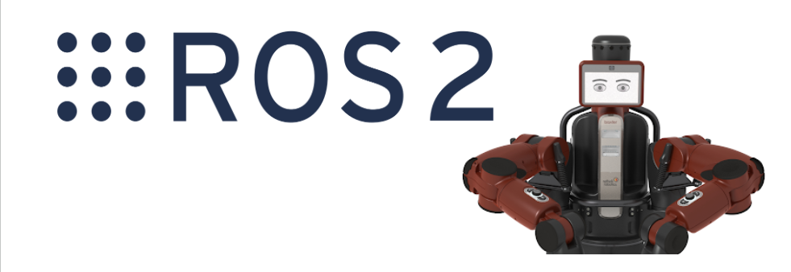

# BringBackBaxter




ROS 2 port of the Baxter robot SDK and MoveIt2 integration. Requires the [Baxter Bridge](https://github.com/RethoughtRobotics/baxter-zenoh) to be running.

---

```bash
git clone git@github.com:RethoughtRobotics/BaxterSDK.git
```

```bash
cd ~/BaxterSDK
```

## 1. One-time setup

**Install dependencies**

```bash
rosdep install --from-paths src --ignore-src -r -y
```

**Build**

```bash
colcon build
source install/setup.bash
```

---

## 2. Each session

**Start the bridge first** (in a separate terminal, see [Baxter Bridge](https://github.com/RethoughtRobotics/baxter-zenoh))

**Source the workspace**

```bash
source install/setup.bash
```

**Terminal 1 - Enable the robot, then start the joint action server**

```bash
ros2 run baxter_tools enable_robot -e
ros2 run baxter_interface joint_trajectory_action_server
```

**Terminal 2 - Launch MoveIt2 with RViz**

```bash
ros2 launch baxter_moveit_config baxter.launch.py
```

---

## 3. Examples

```bash
# Joint position file playback
ros2 run baxter_examples joint_position_file_playback -f <file>

# Joint recorder
ros2 run baxter_examples joint_recorder -f <file> -t <duration>

# Head wobbler
ros2 run baxter_examples head_wobbler

# Gripper cuff control
ros2 run baxter_examples gripper_cuff_control
```

---

## Original ROS 1 SDK

This is a ROS 2 port of Rethink Robotics' Baxter SDK. Baxter itself still runs ROS 1 onboard. The
[Baxter Bridge](https://github.com/RethoughtRobotics/baxter-zenoh) is the only place ROS 1 appears,
inside its container, so nothing here needs ROS 1 installed. To compare a port with the original:

| ROS 1 original | Ported here as |
|---|---|
| [baxter_interface](https://github.com/RethinkRobotics/baxter_interface) | `src/baxter_interface` |
| [baxter_tools](https://github.com/RethinkRobotics/baxter_tools) | `src/baxter_tools` |
| [baxter_examples](https://github.com/RethinkRobotics/baxter_examples) | `src/baxter_examples` |
| [baxter_common](https://github.com/RethinkRobotics/baxter_common) (messages, description) | `src/baxter_common`, `src/baxter_description`, `src/rethink_ee_description` |

---

## FAQ

<details>
<summary><b>MoveIt can't connect to the robot</b></summary>

Make sure the Baxter Bridge is running and you have sourced the workspace:

```bash
source install/setup.bash
ros2 topic echo /robot/joint_states
```

If no messages appear, check the bridge first.

</details>

<details>
<summary><b>Robot won't enable</b></summary>

The robot must be in a safe state (e-stop released, no faults). Check the head display for error indicators, then:

```bash
ros2 run baxter_interface robot_enable
```

</details>

<details>
<summary><b>Building the docs</b></summary>

```bash
sphinx-build -b html docs docs/_build/html
xdg-open docs/_build/html/index.html
```

</details>
