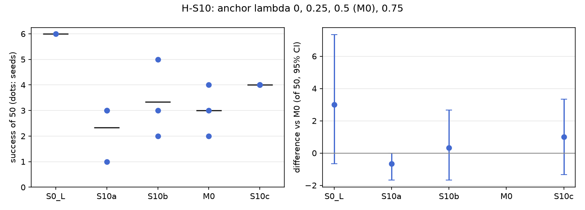

# H-S10: replay against forgetting (anchor lambda)

Plan S10 of RethoughtAI `training/sim_experiments.md` (part 2, every component earns its place): the
real test plan 2, closed loop, with forgetting measured on the layouts the base solved.

## Claim

**Hypothesis H-S10.** Forgetting falls as lambda rises, gain falls only above 0.5. **Null:** no
effect of lambda on forgetting. **Falsified if** S10a forgets no more than M0.

## Conditions

Every condition is M0 with one change, the weight lambda of the anchor loss (replayed base pairs from
episodes 0 to 20).

| # | Anchor lambda | Anchor frames |
|---|---|---|
| S10a | 0 | none |
| S10b | 0.25 | 8456 |
| M0 | 0.5 | 8456 |
| S10c | 0.75 | 8456 |

Kept from M0: LoRA rank 16 on the flow net's 8 linear layers, the 3 cm gate, corrections from pool
episodes 21, 25, 29, 33 (363 corrected frames), 200 steps, batch 256, learning rate 1e-4, alpha 1.
Update seeds 0, 1, 2.

## Data and models

- Base: `andnetdeboer/vita_BlueCupRedContainer_sim_lead640ms_train21_s0-ema` (VITA, episodes 0 to 20,
  training seed 0, 30k steps), trained on
  `andnetdeboer/BlueCupRedContainer_sim_lead640ms_train21@540eca6ef5fabde564ea8c7c23465f8bc1af1db0`.
- Corrections, anchor and open-loop episodes:
  `andnetdeboer/BlueCupRedContainer_sim_lead640ms@b16f755bce0795c50840bb92358d3815b13c046e`, pool
  episodes 21, 25, 29, 33; anchor episodes 0 to 20; open-loop test episodes 38 to 55.
- Adapters not published.

## Closed-loop results

50 test layouts, 40 s per attempt. Difference: success averaged over the three update seeds per
layout, minus M0's, 95% bootstrap interval over layouts, in layouts of 50. Forgetting: mean change in
success on the 6 layouts the base solved (minus 1: all lost).

| Condition | Success of 50 per seed | Mean | Diff vs M0 [95%] | Forgetting | Solved layouts lost per seed (of 6) | Median time (s) | Phase none/reach/grasp/transfer/release (pooled) | Failure modes (pooled) | Corrected frames | Update (s, GPU) |
|---|---|---|---|---|---|---|---|---|---|---|
| S0 (base) | 6 | 6.0 | +3.0 [-0.7, +7.3] | | | 19.3 | 24/12/6/1/7 | missed grasp 23, timeout 8, stalled 8 | | |
| S10a (0) | 1, 3, 3 | 2.3 | -0.7 [-1.7, +0.0] | -0.78 | 5, 5, 4 | 18.1 | 110/9/19/3/9 | missed grasp 67, timeout 33, stalled 23 | 363 | 1.7, A100-PCIE-40GB |
| S10b (0.25) | 2, 3, 5 | 3.3 | +0.3 [-1.7, +2.7] | -0.78 | 5, 4, 5 | 15.9 | 103/17/18/1/11 | missed grasp 80, timeout 23, stalled 22 | 363 | 2.1, A100-SXM4-80GB |
| M0 (0.5) | 4, 3, 2 | 3.0 | | -0.72 | 4, 4, 5 | 16.3 | 90/20/22/6/12 | missed grasp 77, stalled 21, timeout 20 | 363 | 2.1, A100-SXM4-80GB |
| S10c (0.75) | 4, 4, 4 | 4.0 | +1.0 [-1.3, +3.3] | -0.61 | 4, 4, 3 | 16.9 | 84/29/22/2/13 | missed grasp 85, stalled 18, dropped in transit 16 | 363 | 2.3, A100-SXM4-80GB |

Success on the 6 solved layouts against M0 (layouts of 6, 95% interval): S10a -0.33 [-1.00, +0.00],
S10b -0.33 [-1.00, +0.00], S10c +0.67 [-0.67, +1.67].

Update compute is the wall time of the 200 steps on cached latents on a cluster GPU; attempts: none
(offline corrections).

## Open-loop results

Median per-episode path error (mm), alpha 1, mean over the three update seeds.

| Condition | Test episodes 38 to 55 (base 22.3) | Base episodes 0 to 20, forgetting (base 3.3) |
|---|---|---|
| S10a (0) | 27.9 | 15.6 |
| S10b (0.25) | 23.2 | 9.8 |
| M0 (0.5) | 22.5 | 6.7 |
| S10c (0.75) | 22.4 | 4.8 |

## Noise floor

Base training seeds: 6, 2, 3 of 50. Update seeds within one condition span up to 3 of 50 (S10b: 2 to
5). Any closed-loop difference under about 4 of 50 is inside the floor.

## Verdict: inconclusive

- Forgetting falls as lambda rises, in the predicted direction: closed loop -0.78, -0.78, -0.72,
  -0.61 for lambda 0, 0.25, 0.5, 0.75, and clearly open loop (15.6, 9.8, 6.7, 4.8 mm on the base's
  episodes). S10a forgets more than M0 (not falsified), but closed loop only by one layout in 18
  layout-seeds, interval [-1.00, +0.00] of 6, inside the noise.
- The gain part cannot be tested: no lambda gains over the base (2.3 to 4.0 against 6), and success
  does not fall above 0.5 (S10c is the highest at 4.0, +1.0 [-1.3, +3.3] against M0).
- The null (no effect on forgetting) is rejected open loop but not closed loop.

## Threats

- Closed-loop forgetting rests on the 6 layouts the base solved; one layout moves it by 0.17.
- Without a gain, a larger lambda mostly means a smaller update; S10c's lower forgetting may only
  mean the adapter changes the base less, not that replay preserves skills while learning new ones.
- All conditions share the 363 corrected frames from 4 pool demonstrations, and one base (training
  seed 0).
