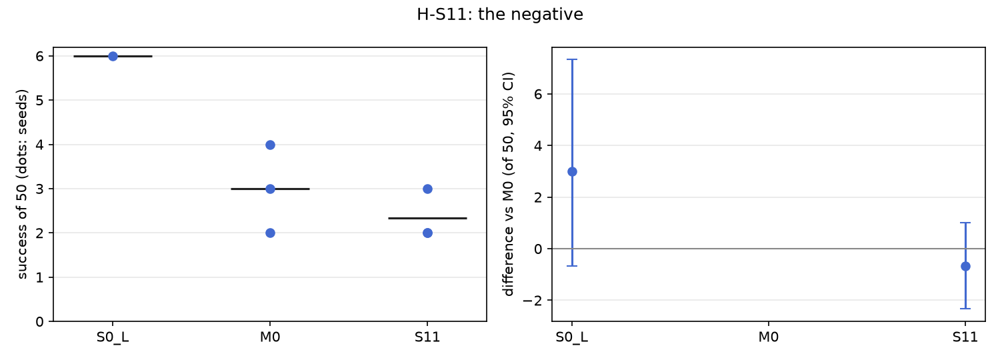

# H-S11: the negative (preference loss against the base's own answer)

Plan S11 of RethoughtAI `training/sim_experiments.md` (part 3): the real test plan 6, closed loop.

## Claim

**Hypothesis H-S11.** The negative adds a small gain. **Null:** none. **Falsified if** the interval
includes zero.

## Conditions

| # | Loss |
|---|---|
| M0 | L1 on the corrected frames plus the anchor (lambda 0.5) |
| S11 | the same plus L_pref, beta 10 |

L_pref is a DPO-style term on the flow error at the same flow time t: with z_h the corrected target
(chosen) and z_pi the base's own plan at that frame (rejected), both measured relative to the frozen
base, L_pref = -log sigmoid(-beta [(l(z_h) - l_ref(z_h)) - (l(z_pi) - l_ref(z_pi))]).

Kept from M0: LoRA rank 16 on the flow net's 8 linear layers (327,680 parameters), the 3 cm gate,
corrections from pool episodes 21, 25, 29, 33 (363 corrected frames), anchor episodes 0 to 20 (8456
frames), 200 steps, batch 256, learning rate 1e-4, alpha 1. Update seeds 0, 1, 2.

### Choice of beta

The plan asks for beta chosen on the adaptation layouts. The sweep used update seed 0, open loop only,
beta 1, 10, 100, 1000, 5000, and took the largest beta with a stable update whose open-loop errors stay
near M0's. No closed-loop test layout was used.

| beta | Open loop test (mm, base 22.3) | Forgetting (mm, base 3.3) | Final corrected / anchor / pref loss |
|---|---|---|---|
| M0 (no pref) | 22.7 | 6.7 | 0.0014 / 0.0003 / |
| 1 | 23.0 | 6.9 | 0.040 / 0.001 / 0.566 |
| 10 (chosen) | 22.5 | 6.9 | 0.075 / 0.027 / 0.199 |
| 100 | 27.3 | 13.6 | 0.078 / 0.030 / 0.058 |
| 1000 | 30.9 | 17.8 | 0.018 / 0.009 / 0.009 |
| 5000 | 25.4 | 12.4 | 0.007 / 0.004 / 0.001 |

All losses were finite. Above beta 10 the open-loop errors on both test and base episodes rise by 3 to
9 mm: the preference term dominates and pulls the adapter away from the demonstrations.

## Data and models

- Base: `andnetdeboer/vita_BlueCupRedContainer_sim_lead640ms_train21_s0-ema` (VITA, episodes 0 to 20,
  training seed 0, 30k steps), trained on
  `andnetdeboer/BlueCupRedContainer_sim_lead640ms_train21@540eca6ef5fabde564ea8c7c23465f8bc1af1db0`.
- Corrections, anchor and open-loop episodes:
  `andnetdeboer/BlueCupRedContainer_sim_lead640ms@b16f755bce0795c50840bb92358d3815b13c046e`, pool
  episodes 21, 25, 29, 33; anchor episodes 0 to 20; open-loop test episodes 38 to 55.
- Adapters not published.

## Closed-loop results

50 test layouts, 40 s per attempt. Difference: success averaged over the three update seeds per
layout, minus M0's, 95% bootstrap interval over layouts, in layouts of 50. Forgetting: mean change in
success on the 6 layouts the base solved (minus 1: all lost).

| Condition | Success of 50 per seed | Mean | Diff vs M0 [95%] | Forgetting | Solved layouts lost per seed (of 6) | Median time (s) | Phase none/reach/grasp/transfer/release (pooled) | Failure modes (pooled) | Corrected frames | Update (s, GPU) |
|---|---|---|---|---|---|---|---|---|---|---|
| S0 (base) | 6 | 6.0 | +3.0 [-0.7, +7.3] | | | 19.3 | 24/12/6/1/7 | missed grasp 23, timeout 8, stalled 8 | | |
| M0 | 4, 3, 2 | 3.0 | | -0.72 | 4, 4, 5 | 16.3 | 90/20/22/6/12 | missed grasp 77, stalled 21, timeout 20 | 363 | 2.1, A100-SXM4-80GB |
| S11 | 3, 2, 2 | 2.3 | -0.7 [-2.3, +1.0] | -0.83 | 5, 5, 5 | 15.0 | 85/27/23/4/11 | missed grasp 82, stalled 20, timeout 19 | 363 | 4.2, A100-SXM4-80GB |

Success on the 6 solved layouts against M0 (layouts of 6, 95% interval): -0.67 [-1.33, +0.00].

Update compute is the wall time of the 200 steps on cached latents on a cluster GPU (the preference
term doubles it: two extra pair errors per step through the frozen base); attempts: none (offline
corrections, the rejected samples are the base's plans at the same frames).

## Open-loop results

Median per-episode path error (mm), alpha 1, mean over the three update seeds.

| Condition | Test episodes 38 to 55 (base 22.3) | Base episodes 0 to 20, forgetting (base 3.3) |
|---|---|---|
| M0 | 22.5 | 6.7 |
| S11 | 22.4 | 6.8 |

## Noise floor

Base training seeds: 6, 2, 3 of 50. M0's update seeds span 2 to 4, S11's 2 to 3. Any closed-loop
difference under about 4 of 50 is inside the floor.

## Verdict: falsified

The interval against M0, -0.7 [-2.3, +1.0] of 50, includes zero, and the point estimate is negative.
The negative adds no gain; S11 also loses one more of the base's solved layouts per seed than M0
(inside the noise). Open loop the two are indistinguishable (22.4 against 22.5 mm). As with M0, S11
stays below the base itself (2.3 against 6 of 50).

## Threats

- Beta was chosen open loop on one update seed. The open-loop test error used in that choice comes
  from the open-loop test episodes 38 to 55, which are demonstrations, not the closed-loop test layouts,
  but they are also the episodes this report's open-loop table uses.
- At beta 10 the corrected-frame L1 at step 200 is about 50 times M0's (0.075 against 0.0014): the
  preference term competes with fitting the corrections, so S11 may simply fit them less. A smaller
  beta (1) fits them better but its pref loss stays near log 2, so the negative barely acts.
- The rejected sample is the base's plan at a demonstration frame, not at a state the base reached on
  its own; on demonstration states the base's plan is often already close to the correction, so the
  pair carries little signal.
- M0 itself gains nothing over the base in this sim (3.0 against 6.0), so a "small gain over M0" is
  measured against a recipe that is already below the floor.
- All evaluations ran with the evaluator's per-layout random lighting (the lab-lighting switch was not
  used), as for every other condition.
