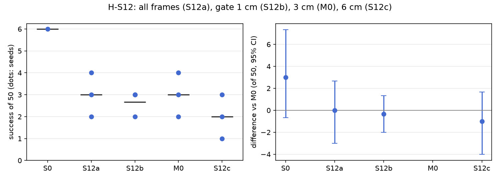

# H-S12: which frames to train on

Plan S12 of RethoughtAI `training/sim_experiments.md` (part 2, every component earns its place): the
real test plan 3, closed loop, plus the gate's threshold.

## Claim

**Hypothesis H-S12.** Gated frames beat all frames; 3 cm is near the best gate. **Null:** all frames
as good. **Falsified if** S12a matches or beats M0.

## Conditions

Every condition is M0 with one change, the gate that picks which frames of the 4 pool episodes become
corrections (a frame is corrected where the base's plan is more than the gate off the demonstration's
chunk). The frame count follows from the gate; it is not equalised.

| # | Frames | Corrected frames (episodes 21 / 25 / 29 / 33) |
|---|---|---|
| S12a | every frame of the 4 episodes | 1686 (494 / 399 / 389 / 404) |
| S12b | off by more than 1 cm | 910 (392 / 117 / 97 / 304) |
| M0 | off by more than 3 cm | 363 (119 / 81 / 27 / 136) |
| S12c | off by more than 6 cm | 165 (51 / 33 / 18 / 63) |

Kept from M0: LoRA rank 16 on the flow net's 8 linear layers, anchor lambda 0.5 on episodes 0 to 20
(8456 frames), 200 steps, batch 256, learning rate 1e-4, alpha 1. Update seeds 0, 1, 2.

## Data and models

- Base: `andnetdeboer/vita_BlueCupRedContainer_sim_lead640ms_train21_s0-ema` (VITA, episodes 0 to 20,
  training seed 0, 30k steps), trained on
  `andnetdeboer/BlueCupRedContainer_sim_lead640ms_train21@540eca6ef5fabde564ea8c7c23465f8bc1af1db0`.
- Corrections, anchor and open-loop episodes:
  `andnetdeboer/BlueCupRedContainer_sim_lead640ms@b16f755bce0795c50840bb92358d3815b13c046e`, pool
  episodes 21, 25, 29, 33; anchor episodes 0 to 20; open-loop test episodes 38 to 55.
- Adapters not published.

## Closed-loop results

50 test layouts, 40 s per attempt. Difference: success averaged over the three update seeds per
layout, minus M0's, 95% bootstrap interval over layouts, in layouts of 50. Forgetting: mean change in
success on the 6 layouts the base solved (minus 1: all lost).

| Condition | Success of 50 per seed | Mean | Diff vs M0 [95%] | Forgetting | Solved layouts lost per seed (of 6) | Median time (s) | Phase none/reach/grasp/transfer/release (pooled) | Failure modes (pooled) | Corrected frames | Update (s, GPU) |
|---|---|---|---|---|---|---|---|---|---|---|
| S0 (base) | 6 | 6.0 | +3.0 [-0.7, +7.3] | | | 19.3 | 24/12/6/1/7 | missed grasp 23, timeout 8, stalled 8 | | |
| S12a (all frames) | 3, 4, 2 | 3.0 | +0.0 [-3.0, +2.7] | -0.83 | 5, 5, 5 | 18.2 | 73/33/26/6/12 | missed grasp 75, stalled 22, dropped in transit 20 | 1686 | 2.1, A100-SXM4-80GB |
| S12b (1 cm) | 3, 2, 3 | 2.7 | -0.3 [-2.0, +1.3] | -0.78 | 5, 5, 4 | 15.9 | 86/25/25/4/10 | missed grasp 77, stalled 24, timeout 20 | 910 | 2.0, A100-SXM4-80GB |
| M0 (3 cm) | 4, 3, 2 | 3.0 | | -0.72 | 4, 4, 5 | 16.3 | 90/20/22/6/12 | missed grasp 77, stalled 21, timeout 20 | 363 | 2.1, A100-SXM4-80GB |
| S12c (6 cm) | 2, 3, 1 | 2.0 | -1.0 [-4.0, +1.7] | -0.94 | 6, 5, 6 | 15.4 | 100/24/17/2/7 | missed grasp 89, stalled 25, timeout 14 | 165 | 2.2, A100-SXM4-80GB |

Success on the 6 solved layouts against M0 (layouts of 6, 95% interval): S12a -0.67 [-3.00, +1.67],
S12b -0.33 [-1.33, +0.67], S12c -1.33 [-3.33, +0.00].

Update compute is the wall time of the 200 steps on cached latents on a cluster GPU; attempts: none
(offline corrections).

## Open-loop results

Median per-episode path error (mm), alpha 1, mean over the three update seeds.

| Condition | Test episodes 38 to 55 (base 22.3) | Base episodes 0 to 20, forgetting (base 3.3) |
|---|---|---|
| S12a (all frames) | 22.9 | 5.0 |
| S12b (1 cm) | 23.0 | 6.0 |
| M0 (3 cm) | 22.5 | 6.7 |
| S12c (6 cm) | 23.3 | 7.0 |

## Noise floor

Base training seeds: 6, 2, 3 of 50. Update seeds within one condition span up to 2 of 50. Any
difference under about 4 of 50 is inside the floor.

## Verdict: falsified

- All frames match the gated frames: S12a 3.0 of 50 against M0's 3.0, +0.0 [-3.0, +2.7]. By the plan's
  rule the claim is falsified; the null (all frames as good) stands.
- No gate stands out: 1 cm (2.7), 3 cm (3.0) and 6 cm (2.0) are all within noise of each other, so
  "3 cm is near the best" cannot be told apart from "the gate does not matter". The 6 cm gate, with
  165 frames, is lowest and forgets most (-0.94), in the expected direction but inside the noise.
- Open loop the gate barely matters either: test error 22.5 to 23.3 mm for all four.
- No condition gains over the base (best 3.0 against 6), so the gate selects among updates that do not
  help.

## Threats

- The gate changes the number of corrected frames (165 to 1686) along with their kind; at a fixed 200
  steps, a larger set also means each frame is seen fewer times.
- Ungated frames on demonstration states are mostly frames where the base already agrees with the
  demonstration, so S12a is close to replaying 4 more demonstrations; with the anchor already
  replaying 21, the extra frames may change little.
- Forgetting rests on the 6 layouts the base solved. One base (training seed 0) and 4 pool
  demonstrations. All evaluations ran with the evaluator's per-layout random lighting, as for every
  condition.
