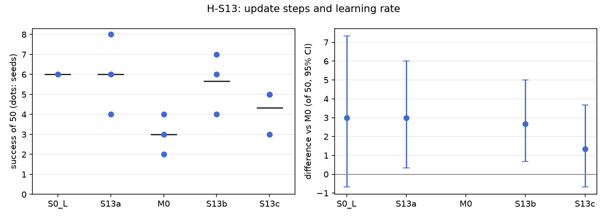

# H-S13: how long to update

Plan S13 of RethoughtAI `training/sim_experiments.md` (part 2, every component earns its place).

## Claim

**Hypothesis H-S13.** Gain saturates by 200 steps; 800 steps or a 10 times rate forget more without
more gain. **Null:** gain keeps rising to 800. **Falsified if** S13b beats M0 beyond noise without
more forgetting.

## Conditions

Every condition is M0 with one change, the number of update steps or the learning rate.

| # | Steps | Learning rate |
|---|---|---|
| S13a | 50 | 1e-4 |
| M0 | 200 | 1e-4 |
| S13b | 800 | 1e-4 |
| S13c | 200 | 1e-3 |

Kept from M0: LoRA rank 16 on the flow net's 8 linear layers, anchor lambda 0.5 on episodes 0 to 20
(8456 frames), the 3 cm gate, corrections from pool episodes 21, 25, 29, 33 (363 corrected frames),
batch 256, alpha 1. Update seeds 0, 1, 2.

## Data and models

- Base: `andnetdeboer/vita_BlueCupRedContainer_sim_lead640ms_train21_s0-ema` (VITA, episodes 0 to 20,
  training seed 0, 30k steps), trained on
  `andnetdeboer/BlueCupRedContainer_sim_lead640ms_train21@540eca6ef5fabde564ea8c7c23465f8bc1af1db0`.
- Corrections, anchor and open-loop episodes:
  `andnetdeboer/BlueCupRedContainer_sim_lead640ms@b16f755bce0795c50840bb92358d3815b13c046e`, pool
  episodes 21, 25, 29, 33; anchor episodes 0 to 20; open-loop test episodes 38 to 55.
- Adapters not published.

## Closed-loop results

50 test layouts, 40 s per attempt. Difference: success averaged over the three update seeds per
layout, minus M0's, 95% bootstrap interval over layouts, in layouts of 50. Forgetting: mean change in
success on the 6 layouts the base solved.

| Condition | Success of 50 per seed | Mean | Diff vs M0 [95%] | Forgetting | Solved layouts lost per seed (of 6) | Median time (s) | Phase none/reach/grasp/transfer/release (pooled) | Failure modes (pooled) | Corrected frames | Update (s, GPU) |
|---|---|---|---|---|---|---|---|---|---|---|
| S0 (base) | 6 | 6.0 | +3.0 [-0.7, +7.3] | | | 19.3 | 24/12/6/1/7 | missed grasp 23, timeout 8, stalled 8 | | |
| S13a (50 steps) | 6, 8, 4 | 6.0 | +3.0 [+0.3, +6.0] | -0.61 | 3, 4, 4 | 16.1 | 75/26/22/4/23 | missed grasp 68, stalled 26, timeout 18 | 363 | 0.8, A100-PCIE-40GB |
| M0 (200, 1e-4) | 4, 3, 2 | 3.0 | | -0.72 | 4, 4, 5 | 16.3 | 90/20/22/6/12 | missed grasp 77, stalled 21, timeout 20 | 363 | 2.1, A100-SXM4-80GB |
| S13b (800 steps) | 7, 4, 6 | 5.7 | +2.7 [+0.7, +5.0] | -0.56 | 3, 4, 3 | 16.8 | 92/14/22/3/19 | missed grasp 67, stalled 32, dropped in transit 19 | 363 | 8.6, A100-PCIE-40GB |
| S13c (lr 1e-3) | 5, 5, 3 | 4.3 | +1.3 [-0.7, +3.7] | -0.67 | 5, 4, 3 | 16.6 | 89/22/17/3/19 | missed grasp 71, stalled 37, released outside 12 | 363 | 2.1, A100-SXM4-80GB |

Success on the 6 solved layouts against M0 (layouts of 6, 95% interval): S13a +0.67 [-0.67, +2.33],
S13b +1.00 [-0.67, +2.67], S13c +0.33 [-1.00, +2.00].

Update compute is the wall time on cached latents on a cluster GPU (S13a and S13b on A100-PCIE-40GB,
M0 and S13c on A100-SXM4-80GB); attempts: none.

## Open-loop results

Median per-episode path error (mm), alpha 1, mean over the three update seeds.

| Condition | Test episodes 38 to 55 (base 22.3) | Base episodes 0 to 20, forgetting (base 3.3) |
|---|---|---|
| S13a | 22.5 | 4.5 |
| M0 | 22.5 | 6.7 |
| S13b | 22.4 | 5.6 |
| S13c | 22.0 | 5.0 |

## Noise floor

Base training seeds: 6, 2, 3 of 50. Update seeds within one condition span up to 4 of 50 (S13a: 4 to
8). Any difference under about 4 of 50 is inside the floor.

## Verdict: inconclusive

- Not falsified: S13b is above M0 with an interval that excludes zero (+2.7 [+0.7, +5.0]) and forgets
  no more (-0.56 against -0.72), but the difference is under the noise floor of about 4 of 50, so it
  does not count as beyond noise under the plan's rule.
- The null is not supported: success does not rise with steps (6.0, 3.0, 5.7 at 50, 200, 800).
- The hypothesis's cost side fails: neither 800 steps nor a 10 times rate forgets more than M0, closed
  loop or open loop.
- No condition gains over the base (best 6.0 against 6), so there is no gain to saturate. M0 is the
  lowest of the four, and S13a and S13b sit at the base's level: the pattern reads as M0's three
  seeds being a low draw, not as an effect of update length.

## Threats

- S13a and S13b both exceed M0 with intervals that exclude zero; if M0 is a low draw, every part 2
  comparison against M0 is shifted by it. A rerun of M0 with more update seeds would settle this.
- Forgetting rests on the 6 layouts the base solved.
- All conditions share the 363 corrected frames from 4 pool demonstrations and one base.
