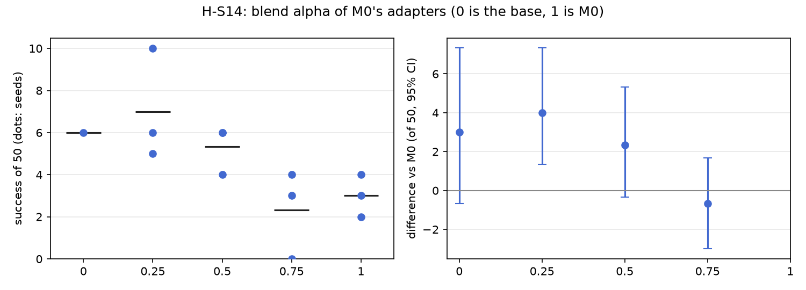

# H-S14: the blend dial

Plan S14 of RethoughtAI `training/sim_experiments.md` (part 2, every component earns its place): the
real test plan 7, closed loop.

## Claim

**Hypothesis H-S14.** Success and forgetting change monotonically with alpha; alpha = 0 reproduces S0.
**Falsified if** an intermediate alpha is worse than both ends.

## Conditions

M0's three adapters, unchanged, run with the adapter's output scaled by alpha (the adapter adds
alpha B A to the frozen weights).

| # | Alpha | Adapters | Evaluation |
|---|---|---|---|
| S0 | 0 | none | the base's own evaluation (an adapter at alpha 0 adds exactly zero) |
| S14 a0.25 | 0.25 | M0 update seeds 0, 1, 2 | new |
| S14 a0.5 | 0.5 | M0 update seeds 0, 1, 2 | new |
| S14 a0.75 | 0.75 | M0 update seeds 0, 1, 2 | new |
| M0 | 1 | M0 update seeds 0, 1, 2 | M0's evaluation |

M0: LoRA rank 16 on the flow net's 8 linear layers, anchor lambda 0.5 on episodes 0 to 20 (8456
frames), the 3 cm gate, corrections from pool episodes 21, 25, 29, 33 (363 corrected frames), 200
steps, batch 256, learning rate 1e-4. No new update was run for S14.

## Data and models

- Base: `andnetdeboer/vita_BlueCupRedContainer_sim_lead640ms_train21_s0-ema` (VITA, episodes 0 to 20,
  training seed 0, 30k steps), trained on
  `andnetdeboer/BlueCupRedContainer_sim_lead640ms_train21@540eca6ef5fabde564ea8c7c23465f8bc1af1db0`.
- Corrections, anchor and open-loop episodes:
  `andnetdeboer/BlueCupRedContainer_sim_lead640ms@b16f755bce0795c50840bb92358d3815b13c046e`, pool
  episodes 21, 25, 29, 33; anchor episodes 0 to 20; open-loop test episodes 38 to 55.
- Adapters not published.

## Closed-loop results

50 test layouts, 40 s per attempt. Difference: success averaged over the three update seeds per
layout, minus M0's (alpha 1), 95% bootstrap interval over layouts, in layouts of 50. Forgetting: mean
change in success on the 6 layouts the base solved (minus 1: all lost).

| Condition | Success of 50 per seed | Mean | Diff vs M0 [95%] | Forgetting | Solved layouts lost per seed (of 6) | Median time (s) | Phase none/reach/grasp/transfer/release (pooled) | Failure modes (pooled) | Corrected frames | Update (s, GPU) |
|---|---|---|---|---|---|---|---|---|---|---|
| S0 (alpha 0) | 6 | 6.0 | +3.0 [-0.7, +7.3] | | | 19.3 | 24/12/6/1/7 | missed grasp 23, timeout 8, stalled 8 | | |
| S14 a0.25 | 6, 10, 5 | 7.0 | +4.0 [+1.3, +7.3] | -0.44 | 3, 1, 4 | 16.4 | 73/21/27/2/27 | missed grasp 63, stalled 21, timeout 19 | 363 (M0's) | none (M0's) |
| S14 a0.5 | 6, 4, 6 | 5.3 | +2.3 [-0.3, +5.3] | -0.72 | 4, 5, 4 | 17.6 | 73/30/26/4/17 | missed grasp 69, stalled 21, timeout 21 | 363 (M0's) | none (M0's) |
| S14 a0.75 | 4, 3, 0 | 2.3 | -0.7 [-3.0, +1.7] | -0.78 | 3, 5, 6 | 15.1 | 87/29/26/0/8 | missed grasp 85, stalled 18, timeout 18 | 363 (M0's) | none (M0's) |
| M0 (alpha 1) | 4, 3, 2 | 3.0 | | -0.72 | 4, 4, 5 | 16.3 | 90/20/22/6/12 | missed grasp 77, stalled 21, timeout 20 | 363 | 2.1, A100-SXM4-80GB |

Against the base (alpha 0), in layouts of 50: a0.25 +1.0 [-3.0, +5.0], a0.5 -0.7 [-5.3, +3.7], a0.75
-3.7 [-8.0, +0.0] (the upper bound is exactly zero), M0 -3.0 [-7.3, +0.7].

Success on the 6 solved layouts against M0 (layouts of 6, 95% interval): a0.25 +1.67 [+0.00, +3.33],
a0.5 +0.00 [-2.00, +2.00], a0.75 -0.33 [-2.00, +1.00].

Cost: none beyond M0's update; alpha is set at run time.

## Open-loop results

Median per-episode path error (mm). Only the ends were measured: the base (alpha 0) 22.3 on test
episodes 38 to 55 and 3.3 on its own episodes 0 to 20; M0 (alpha 1) 22.5 and 6.7. The intermediate
alphas were not run open loop.

## Noise floor

Base training seeds: 6, 2, 3 of 50. Update seeds within one alpha span up to 5 of 50 (a0.25: 5 to 10).
Any difference under about 4 of 50 is inside the floor.

## Verdict: inconclusive

- Not falsified: alpha 0.75 has the lowest mean (2.3), below both ends (6 at alpha 0, 3.0 at alpha 1),
  but against alpha 1 the difference is -0.7 [-3.0, +1.7], well inside the noise. No intermediate
  alpha is worse than both ends beyond noise.
- Roughly monotone, but in the direction of no gain: from alpha 0.25 up, success falls (7.0, 5.3, 2.3,
  3.0) and forgetting grows (-0.44, -0.72, -0.78, -0.72); both deviations from strict monotonicity
  (alpha 0.25 above the base, alpha 1 above 0.75) are within noise.
- The smallest dial is the best setting: alpha 0.25 beats full M0 by +4.0 [+1.3, +7.3], at the noise
  floor, keeps more of the base's solved layouts (+1.67 [+0.00, +3.33] of 6), and is level with the
  base (+1.0 [-3.0, +5.0]). Turning the adapter down mostly undoes the harm of M0's update rather than
  adding a gain.
- Alpha 0 reproduces S0 by construction (the adapter adds zero); it was not run as a separate
  evaluation.

## Threats

- Without a gain at any alpha, monotonicity is tested only on the cost side; the trade-off the dial is
  meant to set (gain against forgetting) does not exist here.
- S14 a0.75 seed 2 scores 0 of 50; its failure profile (missed grasp 29, dropped in transit 6, stalled
  5, timeout 7) is like seed 0's, so it reads as a low draw, not a broken run.
- The alpha 0 and alpha 1 rows reuse the base's and M0's earlier evaluations, run with an earlier
  version of the sim tooling than most S14 runs; the layouts, lighting draws and runtime profile are
  the same.
- Forgetting rests on the 6 layouts the base solved. One base (training seed 0). All evaluations ran
  with the evaluator's per-layout random lighting, as for every condition.
