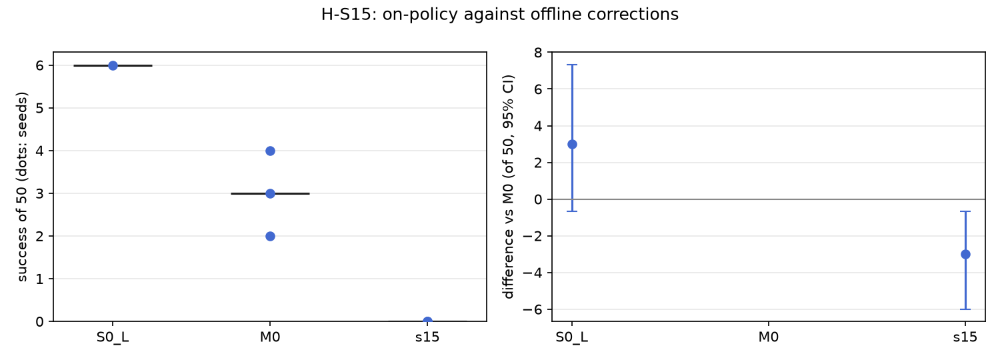

# H-S15: corrections on the policy's own states

Plan S15 of RethoughtAI `training/sim_experiments.md` (part 3, the correction signal).

## Claim

**Hypothesis H-S15.** On-policy corrections, collected by running S0 on the adaptation layouts with
the planner gating at 3 cm, beat M0's offline corrections at the same number of corrected frames.
**Null:** no difference. **Expected outcome:** S15 above M0, mostly fewer stalled attempts.
**Falsified if** the interval includes zero.

## Conditions

| # | Corrections | What changed against M0 |
|---|---|---|
| M0 | offline: pool demonstrations 21, 25, 29, 33, where the base's plan is more than 3 cm off the demonstration's chunk | |
| S15 | on-policy: the base's own attempts on adaptation layouts 500 to 519; wherever its plan is more than 3 cm off the scripted planner's, replanned from the arm's and the cup's current poses, the planner's chunk is the target | the correction source only; capped at M0's 363 corrected frames, drawn at random with the update seed |

Kept from M0: LoRA rank 16 on the flow net, anchor lambda 0.5 on episodes 0 to 20, 200 steps,
batch 256, learning rate 1e-4, alpha 1. Update seeds 0, 1, 2. The planner's chunks are relabelled
as the base's training labels are (pose led by 16 steps, gripper on time).

## Data and models

- Base: `andnetdeboer/vita_BlueCupRedContainer_sim_lead640ms_train21_s0-ema` (VITA, episodes 0 to 20,
  training seed 0, 30k steps), trained on
  `andnetdeboer/BlueCupRedContainer_sim_lead640ms_train21@540eca6ef5fabde564ea8c7c23465f8bc1af1db0`.
- Anchor and open-loop episodes: `andnetdeboer/BlueCupRedContainer_sim_lead640ms@b16f755bce0795c50840bb92358d3815b13c046e`.
- Attempts: one base attempt per adaptation layout (20 attempts, 13,616 frames, 902 without a
  planner chunk). 7,805 frames (57%) were gated; 363 of them were used per update seed. The gated
  frames per layout ranged from 2 to 53.
- Adapters not published.

## Closed-loop results

50 test layouts, success averaged over the three update seeds per layout, paired against M0, 95%
bootstrap interval over layouts, in layouts of 50.

| Condition | Success of 50 per seed | Mean | Diff vs M0 [95%] | Forgetting | Median time (s) | Phase none/reach/grasp/transfer/release (pooled) | Failure modes (pooled) | Corrected frames | Attempts | Update (s, GPU) |
|---|---|---|---|---|---|---|---|---|---|---|
| S0 (base) | 6 | 6.0 | +3.0 [-0.7, +7.3] | | 19.3 | 24/12/6/1/7 | missed grasp 23, timeout 8, stalled 8 | | | |
| M0 | 4, 3, 2 | 3.0 | | -0.72 | 16.3 | 90/20/22/6/12 | missed grasp 77, stalled 21, timeout 20 | 363 | 0 | 2.1, A100-SXM4-80GB |
| S15 | 0, 0, 0 | 0.0 | -3.0 [-6.0, -0.7] | -1.00 | | 89/44/13/4/0 | stalled 58, missed grasp 46, timeout 35 | 363 | 20 | 2.4, A100-PCIE-40GB |

Simulated robot time for the attempts: at most 20 attempts of 40 s (about 13 min).

## Open-loop results

Median per-episode path error (mm), alpha 1, mean over update seeds.

| Condition | Test episodes 38 to 55 (base 22.3) | Base episodes 0 to 20 (base 3.3) |
|---|---|---|
| M0 | 22.5 | 6.7 |
| S15 | 28.6 | 14.6 |

## Noise floor

Base training seeds: 6, 2, 3 of 50. M0's update seeds: 4, 3, 2. S15's three seeds agree exactly (0).

## Verdict: falsified

The interval excludes zero, but in the opposite direction to the claim: S15 is below M0 by 3 of 50
[-6.0, -0.7], it loses every layout the base solved, and stalled attempts rise (58 pooled against
M0's 21), the opposite of the expected outcome. Open loop it also moves away from the
demonstrations, both on held-out test episodes (28.6 against 22.5 mm) and on the base's own episodes
(14.6 against 6.7 mm).

## Threats

- **Corrector and demonstrations may disagree.** 57% of the base's own frames were gated, and 363
  planner chunks shift the open-loop error on the base's own episodes by more than twice what M0's
  363 demonstration chunks do. Either the planner's replanned chunks differ systematically from how
  the demonstrations move (another path, timing or gripper schedule, so the anchor and the
  corrections pull apart), or a timing or frame mismatch between the recorded observation and the
  planner's chunk remains in the extraction. A check that would separate the two: gate the planner
  against the demonstrations themselves (planner chunks at demonstration states against the
  demonstrations' labels); a large gap there means the corrector, not the method, is what S15
  measures. This result should not be read as evidence against on-policy correction until that check
  is done.
- The cap draws 363 of 7,805 gated frames at random, so most layouts contribute few frames; frames
  are not weighted toward where the base fails.
- One base attempt per layout; the base is weak (6 of 50), so most attempts are failures and many
  gated frames come from states far from any successful path.
