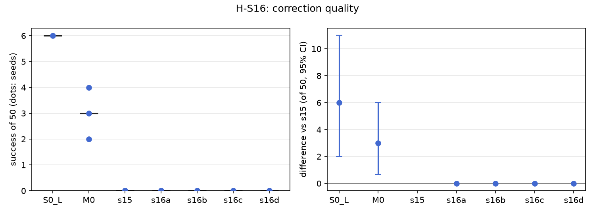

# H-S16: how good must a correction be?

Plan S16 of RethoughtAI `training/sim_experiments.md` (part 3): S15's on-policy planner corrections,
degraded on purpose to stand in for a person who corrects late, partly and imprecisely.

## Claim

**Hypothesis H-S16.** Late corrections keep most of the gain; partial and noisy ones lose more but stay
above S0. **Null:** no degradation loses more than the noise floor. **Falsified if** every degradation
is within noise of S15.

## Conditions

| # | S15's corrections, degraded | Corrected frames per update seed |
|---|---|---|
| S15 | exact | 363, 363, 363 |
| S16a | the planner's chunk taken 0.5 s late (frames whose late chunk falls off the attempt are lost) | 362, 356, 356 |
| S16b | the first half of each chunk only | 363, 363, 363 |
| S16c | 2 cm Gaussian noise per waypoint | 363, 363, 363 |
| S16d | 30% of the gated frames dropped | 254, 254, 254 |

Everything else is S15's: the same 20 base attempts on adaptation layouts 500 to 519, the same 3 cm
gate (7,805 gated frames), capped at M0's 363 corrected frames drawn with the update seed, LoRA rank 16
on the flow net, anchor lambda 0.5 on episodes 0 to 20, 200 steps, batch 256, learning rate 1e-4,
alpha 1. Update seeds 0, 1, 2.

## Data and models

- Base: `andnetdeboer/vita_BlueCupRedContainer_sim_lead640ms_train21_s0-ema` (VITA, episodes 0 to 20,
  training seed 0, 30k steps), trained on
  `andnetdeboer/BlueCupRedContainer_sim_lead640ms_train21@540eca6ef5fabde564ea8c7c23465f8bc1af1db0`.
- Anchor and open-loop episodes: `andnetdeboer/BlueCupRedContainer_sim_lead640ms@b16f755bce0795c50840bb92358d3815b13c046e`.
- Attempts: S15's (one base attempt per adaptation layout, 20 attempts, 13,616 frames).
- Adapters not published.

## Closed-loop results

50 test layouts, 40 s per attempt. Difference: success averaged over the three update seeds per
layout, minus S15's, 95% bootstrap interval over layouts, in layouts of 50. Forgetting: mean change in
success on the 6 layouts the base solved (minus 1: all lost).

| Condition | Success of 50 per seed | Mean | Diff vs S15 [95%] | Forgetting | Phase none/reach/grasp/transfer/release (pooled) | Failure modes (pooled) | Corrected frames | Update (s, GPU) |
|---|---|---|---|---|---|---|---|---|
| S0 (base) | 6 | 6.0 | +6.0 [+2.0, +11.0] | | 24/12/6/1/7 | missed grasp 23, timeout 8, stalled 8 | | |
| M0 (offline demonstrations) | 4, 3, 2 | 3.0 | +3.0 [+0.7, +6.0] | -0.72 | 90/20/22/6/12 | missed grasp 77, stalled 21, timeout 20 | 363 | 2.1, A100-SXM4-80GB |
| S15 | 0, 0, 0 | 0.0 | | -1.00 | 89/44/13/4/0 | stalled 58, missed grasp 46, timeout 35 | 363 | 2.4, A100-PCIE-40GB |
| S16a (late) | 0 (of 37), 0, 0 | 0.0 | +0.0 [+0.0, +0.0] | -1.00 | 76/38/14/8/1 | stalled 57, missed grasp 40, timeout 26 | 358 | 2.2, A100-SXM4-80GB |
| S16b (half chunk) | 0, 0, 0 | 0.0 | +0.0 [+0.0, +0.0] | -1.00 | 84/52/9/5/0 | stalled 68, missed grasp 46, timeout 27 | 363 | 2.2, A100-SXM4-80GB |
| S16c (noise) | 0, 0, 0 | 0.0 | +0.0 [+0.0, +0.0] | -1.00 | 86/49/8/7/0 | stalled 58, missed grasp 47, timeout 37 | 363 | 5.5, A100-SXM4-80GB |
| S16d (dropped) | 0, 0, 0 | 0.0 | +0.0 [+0.0, +0.0] | -1.00 | 90/41/11/8/0 | stalled 62, missed grasp 43, timeout 35 | 254 | 2.0, A100-SXM4-80GB |

S16a's update seed 0 has 37 of 50 layouts (one stack's sim did not come up); its rerun is queued and
cannot change the verdict unless it succeeds on most of the 13 missing layouts.

Cost: 20 base attempts (shared with S15), the corrected frames above, update compute on a cluster GPU.

## Open-loop results

Median per-episode path error (mm), alpha 1, mean over the three update seeds.

| Condition | Test episodes 38 to 55 (base 22.3) | Base episodes 0 to 20, forgetting (base 3.3) |
|---|---|---|
| M0 | 22.5 | 6.7 |
| S15 | 28.6 | 14.6 |
| S16a | 28.5 | 13.7 |
| S16b | 28.5 | 14.0 |
| S16c | 28.5 | 14.5 |
| S16d | 28.5 | 14.1 |

Every degradation leaves the open-loop errors where S15 put them, about 6 mm above M0 on the test
episodes and twice M0's forgetting.

## Noise floor

Base training seeds: 6, 2, 3 of 50. Every S15 and S16 adapter scores 0 on every update seed, so the
seed spread is zero here.

## Verdict: falsified

Every degradation is within noise of S15 (all at 0 of 50, intervals [+0.0, +0.0]), so by the plan's
rule the claim is falsified; none stays above S0 either. The result is degenerate rather than
informative about correction quality: S15 itself has no gain to lose (0 of 50 against M0's 3.0 and the
base's 6), so degrading its corrections cannot be measured. H-S16 needs a correction source that gains
first; with the planner as corrector in this sim, it does not.

## Threats

- S15's failure dominates: the H-S15 diagnosis found the planner matches the demonstrations' label
  convention, but the 3 cm gate selects mostly frames from stalled and timed-out attempts (63% of
  corrected frames) and pace differences (46.5% of gated frames lie within 3 cm after a time shift), and
  the planner leaves home at once where the demonstrations idle for about 30 frames. Training on these
  teaches the base to stall (S15 and S16: 57 to 68 stalled attempts pooled against 21 for M0).
  Degrading such corrections changes nothing because the frames themselves are the problem.
- S16d uses fewer frames (254) than the others (363), so it confounds dropping with a smaller update.
- S16a loses up to 7 frames whose late chunk runs past the attempt's end.
- All evaluations ran with the evaluator's per-layout random lighting, as for every condition.
