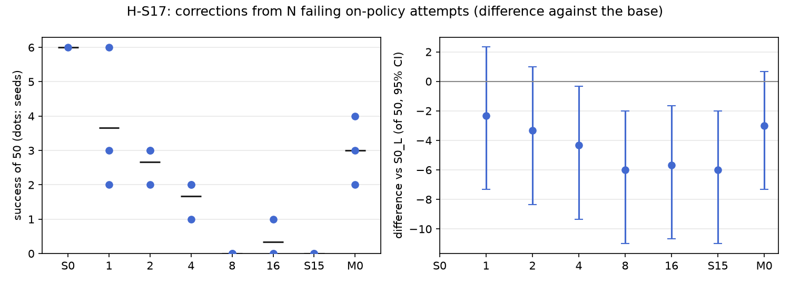

# H-S17: how many corrections?

Plan S17 of RethoughtAI `training/sim_experiments.md` (part 3, the correction signal): the real test
plan 4, on-policy and closed loop.

## Claim

**Hypothesis H-S17.** Most of the gain by 4 attempts. **Null:** gain rises steadily to 16.
**Falsified if** the gain from 4 to 16 exceeds the gain from 1 to 4.

## Conditions

S15's on-policy corrections, taken from the first N failing base attempts instead of all 20 attempts,
with every gated frame of those attempts used (no cap). Gain is success minus the base's.

| # | Attempts used (adaptation layouts) | How those attempts failed | Corrected frames |
|---|---|---|---|
| N = 1 | 501 | stalled | 127 |
| N = 2 | 501, 502 | plus timeout | 942 |
| N = 4 | 501 to 504 | plus stalled, timeout | 2066 |
| N = 8 | 501 to 508 | plus 2 missed grasps, 2 timeouts | 4553 |
| N = 16 | every failing attempt: 501 to 511, 513, 515 to 517, 519 | plus 5 missed grasps, 2 stalled, 1 timeout | 6755 |
| S15 | all 20 attempts (the 16 failing and 4 successful ones, 500, 512, 514, 518) | | 363 of 7,805 gated, drawn with the update seed |

The attempts are S15's: one base attempt per adaptation layout 500 to 519, the scripted planner as the
corrector, replanned from the arm's and the cup's current poses, with the 3 cm gate. Everything else
is S15's and M0's: LoRA rank 16 on the flow net's 8 linear layers, anchor lambda 0.5 on episodes 0 to
20 (8456 frames), 200 steps, batch 256, learning rate 1e-4, alpha 1. Update seeds 0, 1, 2.

## Data and models

- Base: `andnetdeboer/vita_BlueCupRedContainer_sim_lead640ms_train21_s0-ema` (VITA, episodes 0 to 20,
  training seed 0, 30k steps), trained on
  `andnetdeboer/BlueCupRedContainer_sim_lead640ms_train21@540eca6ef5fabde564ea8c7c23465f8bc1af1db0`.
- Anchor and open-loop episodes: `andnetdeboer/BlueCupRedContainer_sim_lead640ms@b16f755bce0795c50840bb92358d3815b13c046e`.
- Attempts: S15's (one base attempt per adaptation layout, 20 attempts, 13,616 frames; 4 succeeded).
- Adapters not published.

## Closed-loop results

50 test layouts, 40 s per attempt. Difference: success averaged over the three update seeds per
layout, minus M0's, 95% bootstrap interval over layouts, in layouts of 50. Forgetting: mean change in
success on the 6 layouts the base solved (minus 1: all lost).

| Condition | Success of 50 per seed | Mean | Diff vs M0 [95%] | Forgetting | Solved layouts lost per seed (of 6) | Median time (s) | Phase none/reach/grasp/transfer/release (pooled) | Failure modes (pooled) | Corrected frames | Update (s, GPU) |
|---|---|---|---|---|---|---|---|---|---|---|
| S0 (base) | 6 | 6.0 | +3.0 [-0.7, +7.3] | | | 19.3 | 24/12/6/1/7 | missed grasp 23, timeout 8, stalled 8 | | |
| M0 (offline demonstrations) | 4, 3, 2 | 3.0 | | -0.72 | 4, 4, 5 | 16.3 | 90/20/22/6/12 | missed grasp 77, stalled 21, timeout 20 | 363 | 2.1, A100-SXM4-80GB |
| N = 1 | 3, 2, 6 | 3.7 | +0.7 [-3.0, +4.0] | -0.89 | 5, 5, 6 | 16.7 | 73/48/16/2/11 | missed grasp 83, stalled 22, timeout 19 | 127 | 2.0, A100-SXM4-80GB |
| N = 2 | 3, 3, 2 | 2.7 | -0.3 [-4.0, +3.3] | -0.83 | 5, 5, 5 | 13.9 | 80/38/14/8/10 | missed grasp 78, stalled 25, timeout 22 | 942 | 2.0, A100-SXM4-80GB |
| N = 4 | 1, 2, 2 | 1.7 | -1.3 [-4.7, +1.3] | -0.94 | 6, 5, 6 | 21.0 | 52/63/29/1/5 | stalled 62, missed grasp 37, dropped in transit 27 | 2066 | 2.0, A100-SXM4-80GB |
| N = 8 | 0, 0, 0 | 0.0 | -3.0 [-6.0, -0.7] | -1.00 | 6, 6, 6 | | 84/50/7/9/0 | stalled 63, missed grasp 51, timeout 29 | 4553 | 2.3, A100-SXM4-80GB |
| N = 16 | 0, 1, 0 | 0.3 | -2.7 [-5.7, -0.3] | -1.00 | 6, 6, 6 | 19.0 | 102/34/6/6/2 | stalled 67, timeout 44, missed grasp 32 | 6755 | 2.0, A100-SXM4-80GB |
| S15 (20 attempts, capped) | 0, 0, 0 | 0.0 | -3.0 [-6.0, -0.7] | -1.00 | 6, 6, 6 | | 89/44/13/4/0 | stalled 58, missed grasp 46, timeout 35 | 363 | 2.4, A100-PCIE-40GB |

Gain against the base, in layouts of 50: N = 1 -2.3 [-7.3, +2.3], N = 2 -3.3 [-8.3, +1.0], N = 4 -4.3
[-9.3, -0.3], N = 8 -6.0 [-11.0, -2.0], N = 16 -5.7 [-10.7, -1.7] (S15 -6.0 [-11.0, -2.0], M0 -3.0
[-7.3, +0.7]).

The plan's comparison, paired over layouts: gain from 1 to 4 attempts -2.0 [-4.7, +0.7], from 4 to 16
-1.3 [-3.0, +0.0]; the second minus the first +0.7 [-3.0, +4.0]. From 1 to 16: -3.3 [-6.0, -1.0].

Cost: N base attempts of at most 40 s each (N = 16: at most about 11 min of simulated robot time), the
corrected frames above, update compute on a cluster GPU (about 2 s at every N, since the step count is
fixed).

## Open-loop results

Median per-episode path error (mm), alpha 1, mean over the three update seeds.

| Condition | Test episodes 38 to 55 (base 22.3) | Base episodes 0 to 20, forgetting (base 3.3) |
|---|---|---|
| M0 | 22.5 | 6.7 |
| N = 1 | 26.3 | 6.8 |
| N = 2 | 26.0 | 9.2 |
| N = 4 | 29.6 | 12.7 |
| N = 8 | 29.1 | 14.8 |
| N = 16 | 28.8 | 15.0 |
| S15 | 28.6 | 14.6 |

## Noise floor

Base training seeds: 6, 2, 3 of 50. Update seeds within one condition span up to 4 of 50 (N = 1: 2 to
6). Any difference under about 4 of 50 is inside the floor.

## Verdict: inconclusive

- There is no gain to saturate: every N is below the base (from -2.3 at N = 1 to -6.0 at N = 8), and
  success falls as attempts are added (3.7, 2.7, 1.7, 0.0, 0.3 for N = 1, 2, 4, 8, 16; 1 to 16 -3.3
  [-6.0, -1.0]). Both the hypothesis (most of the gain by 4) and the null (gain rising to 16)
  presuppose a gain, and the data show a loss that grows with N.
- The plan's rule cannot be decided: the change from 4 to 16 (-1.3) and from 1 to 4 (-2.0) are both
  losses and their difference is +0.7 [-3.0, +4.0], inside the noise.
- Open loop shows the same dose response: test error rises from 26.3 to about 29 mm and error on the
  base's own episodes from 6.8 to 15.0 mm as attempts are added, levelling off from N = 4 at S15's
  values.
- Stalls take over with more corrections: stalled attempts pooled 22, 25, 62, 63, 67 for N = 1 to 16,
  against 21 for M0. One stalled attempt's 127 frames (N = 1) leave the policy at M0's level (+0.7
  [-3.0, +4.0]); from N = 4 on, the update reproduces S15's failure.

## Threats

- S15's corrector diagnosis applies to every N: the planner matches the demonstrations' label
  convention, but most gated frames come from stalled and timed-out attempts (63% of gated frames
  across the 20 attempts) and from pace differences (46.5% of gated frames lie within 3 cm after a
  time shift); the planner also leaves home at once where the demonstrations idle for about 30 frames.
  The first four failing attempts are all stalled or timed out, so N = 4 is made of exactly the frames
  the diagnosis flags.
- The corrected frame count grows with N (127 to 6755) at a fixed 200 steps, so N confounds the number
  of attempts with the number of frames and how often each is seen. S15, capped at 363 frames drawn
  from all 20 attempts, fails the same way as N = 16 with 6755, so frame count alone does not explain
  the loss.
- The attempts are taken in layout order, not drawn at random; a different first attempt could change
  N = 1 and N = 2.
- Forgetting rests on the 6 layouts the base solved. One base (training seed 0). All evaluations and
  attempts ran with the evaluator's per-layout random lighting, as for every condition.
