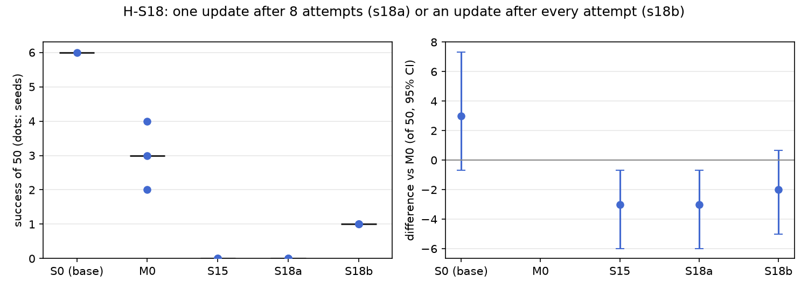

# H-S18: update once, or after every attempt?

Plan S18 of RethoughtAI `training/sim_experiments.md` (part 3, the correction signal): on the robot,
corrections arrive one attempt at a time, and updating between attempts lets the next attempt fail
differently.

## Claim

**Hypothesis H-S18.** Updating after every attempt reaches the same success with fewer corrected
frames. **Null:** no difference. **Falsified if** S18b needs as many frames as S18a.

## Conditions

8 attempts in all, on adaptation layouts 500 to 507, with S15's on-policy corrector: the scripted
planner, replanned from the arm's and the cup's current poses, its chunk the target wherever the
base's plan is more than 3 cm off it. Every gated frame is used (no cap).

| # | Schedule | Attempts | Corrected frames per update seed |
|---|---|---|---|
| S18a | one update after all 8 | S15's base attempts on 500 to 507 (500 succeeded; 501 to 507 failed: 2 stalled, 3 timeouts, 2 missed grasps) | 4003, 4003, 4003 |
| S18b | an update after every attempt, on all corrections so far; attempt i runs with the adapter of the update before it, the eighth update is the one tested | attempt 0: the base on 500 again (shared by the update seeds); attempts 1 to 7 on 501 to 507 with the adapter so far | 2706, 3584, 3514 |

S18b's gate compares the planner with the base's plan (not the adapter's) at the states the adapted
policy reached. Its first attempt is a new base attempt on layout 500, because the recording of S15's
attempt there had been deleted; this new attempt failed (dropped in transit), where S15's succeeded.
Each S18b update starts from the base and trains on the corrections of all attempts so far.

Kept from S15 and M0: LoRA rank 16 on the flow net's 8 linear layers, anchor lambda 0.5 on episodes 0
to 20 (8456 frames), 200 steps, batch 256, learning rate 1e-4, alpha 1. Update seeds 0, 1, 2.

## Data and models

- Base: `andnetdeboer/vita_BlueCupRedContainer_sim_lead640ms_train21_s0-ema` (VITA, episodes 0 to 20,
  training seed 0, 30k steps), trained on
  `andnetdeboer/BlueCupRedContainer_sim_lead640ms_train21@540eca6ef5fabde564ea8c7c23465f8bc1af1db0`.
- Anchor and open-loop episodes: `andnetdeboer/BlueCupRedContainer_sim_lead640ms@b16f755bce0795c50840bb92358d3815b13c046e`.
- Attempts: S18a uses S15's first 8 base attempts; S18b records its own 8 per update seed (one base
  attempt shared, 7 with adapters).
- Adapters not published.

## Closed-loop results

50 test layouts, 40 s per attempt. Difference: success averaged over the three update seeds per
layout, minus M0's, 95% bootstrap interval over layouts, in layouts of 50. Forgetting: mean change in
success on the 6 layouts the base solved (minus 1: all lost).

| Condition | Success of 50 per seed | Mean | Diff vs M0 [95%] | Forgetting | Solved layouts lost per seed (of 6) | Median time (s) | Phase none/reach/grasp/transfer/release (pooled) | Failure modes (pooled) | Corrected frames | Attempts | Update (s, GPU) |
|---|---|---|---|---|---|---|---|---|---|---|---|
| S0 (base) | 6 | 6.0 | +3.0 [-0.7, +7.3] | | | 19.3 | 24/12/6/1/7 | missed grasp 23, timeout 8, stalled 8 | | | |
| M0 (offline demonstrations) | 4, 3, 2 | 3.0 | | -0.72 | 4, 4, 5 | 16.3 | 90/20/22/6/12 | missed grasp 77, stalled 21, timeout 20 | 363 | 0 | 2.1, A100-SXM4-80GB |
| S15 (20 attempts, capped) | 0, 0, 0 | 0.0 | -3.0 [-6.0, -0.7] | -1.00 | 6, 6, 6 | | 89/44/13/4/0 | stalled 58, missed grasp 46, timeout 35 | 363 | 20 | 2.4, A100-PCIE-40GB |
| S18a (one update) | 0, 0, 0 | 0.0 | -3.0 [-6.0, -0.7] | -1.00 | 6, 6, 6 | | 93/42/10/5/0 | stalled 51, missed grasp 47, timeout 44 | 4003, 4003, 4003 | 8 | 2.1, A100-SXM4-80GB |
| S18b (update after every attempt) | 1, 1, 1 | 1.0 | -2.0 [-5.0, +0.7] | -1.00 | 6, 6, 6 | 28.9 | 80/39/21/6/4 | stalled 57, timeout 49, missed grasp 30 | 2706, 3584, 3514 | 8 | 2.2 per update (8 updates), A100-PCIE-40GB |

The plan's comparison, paired over layouts: S18b minus S18a +1.0 [+0.0, +2.3]. Against the base: S18a
-6.0 [-11.0, -2.0], S18b -5.0 [-10.3, -0.7] (M0 -3.0 [-7.3, +0.7]). S18b's three successes are on
three different test layouts (1006, 1028, 1037), none of them one the base solved.

S18b's attempts on the adaptation layouts, per update seed (attempt 0 is the shared base attempt):

| Attempt (layout) | Policy | Seed 0 | Seed 1 | Seed 2 |
|---|---|---|---|---|
| 0 (500) | base | dropped in transit | (shared) | (shared) |
| 1 (501) | update 0 | stalled | stalled | stalled |
| 2 (502) | update 1 | missed grasp | missed grasp | missed grasp |
| 3 (503) | update 2 | stalled | stalled | missed grasp |
| 4 (504) | update 3 | stalled | missed grasp | stalled |
| 5 (505) | update 4 | stalled | missed grasp | timeout |
| 6 (506) | update 5 | stalled | missed grasp | missed grasp |
| 7 (507) | update 6 | stalled | timeout | timeout |
| Corrected frames after each update 0 to 7 | | 247, 373, 524, 649, 1102, 1546, 2192, 2706 | 247, 373, 501, 639, 1474, 1595, 2587, 3584 | 247, 374, 553, 664, 1173, 1931, 2518, 3514 |

No S18b attempt succeeded (0 of 8 per seed, 0 of 22 attempts in all); S18a's 8 base attempts include
one success (500). The base's own attempts on 501 to 507 failed too, so updating between attempts did
not turn any adaptation layout into a success.

Cost: simulated robot time of the 8 attempts 229 s for S18a, 179, 244 and 242 s for S18b's seeds;
update compute on a cluster GPU, about 2 s per update (S18b runs 8 updates per seed, about 17 s in
all).

## Open-loop results

Median per-episode path error (mm), alpha 1, mean over the three update seeds (S18b: the eighth
update).

| Condition | Test episodes 38 to 55 (base 22.3) | Base episodes 0 to 20, forgetting (base 3.3) |
|---|---|---|
| M0 | 22.5 | 6.7 |
| S15 | 28.6 | 14.6 |
| S18a | 29.8 | 15.6 |
| S18b | 28.0 | 12.5 |

## Noise floor

Base training seeds: 6, 2, 3 of 50. Update seeds agree within each condition here (S18a 0, 0, 0;
S18b 1, 1, 1); M0's span 2 to 4. Any difference under about 4 of 50 is inside the floor.

## Verdict: inconclusive

- By the letter, the claim stands: S18b used fewer corrected frames than S18a (2706 to 3584 against
  4003, 18% fewer on average) and its success is not below S18a's (+1.0 [+0.0, +2.3], inside the
  noise).
- But the "same success" both reach is no success: S18a scores 0 of 50 and S18b 1 of 50 on every
  seed, both below the base (6) and M0 (3.0), and both lose every layout the base solved. The
  hypothesis is about reaching a gain more cheaply, and neither schedule gains, so the frame
  comparison carries no information about efficiency.
- S18b's fewer frames are not a saving it chose: they come from shorter attempts (its adapted
  attempts stall early, attempt 1 after 5 s on every seed) and the gate, at a similar robot time
  (179 to 244 s against 229 s).
- Updating between attempts did not make the next attempt succeed: 0 of 22 adapted and new base
  attempts succeeded, and stalls stay the main failure (57 pooled at test, against 21 for M0).

## Threats

- S15's corrector diagnosis applies: the planner matches the demonstrations' label convention, but
  most gated frames come from stalled and timed-out attempts (63% across S15's 20 attempts) and from
  pace differences (46.5% of gated frames lie within 3 cm after a time shift); the planner leaves home
  at once where the demonstrations idle for about 30 frames. 5 of S18a's 7 failed attempts stalled or
  timed out, and most of S18b's adapted attempts stalled.
- The two schedules do not share the same attempts: S18b's first attempt on layout 500 was recorded
  again and failed where S15's succeeded, and its later attempts depend on its adapters. Frame counts
  therefore differ for reasons other than the schedule.
- S18b's gate measures the base's plan, not the current adapter's, at the adapted policy's states.
- The closed loop is not deterministic (bit-identical adapters elsewhere scored 2, 2, 2 and 1, 3, 3),
  so S18b's 1 against S18a's 0 per seed is within evaluation noise. Some S18a seeds and S18b seed 0's
  test evaluation were completed by reruns of their missing layouts; every run has all 50 layouts.
- One base (training seed 0). All evaluations and attempts ran with the evaluator's per-layout random
  lighting, as for every condition.
