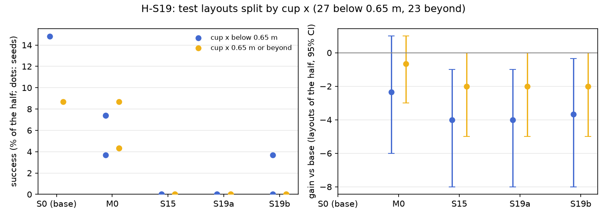

# H-S19: to conditions the corrections never saw

Plan S19 of RethoughtAI `training/sim_experiments.md` (part 4, does it generalise?): a fix that only
holds on the layouts it was corrected on is memorisation.

## Claim

**Hypothesis H-S19.** Corrections collected only on cups at x below 0.65 m improve test layouts beyond
0.65 m about as much as below; corrections under the lab's lighting hold under random lighting.
**Null:** gain only where corrected. **Expected outcome.** Gain beyond 0.65 m at least half the gain
below. **Falsified if** the beyond 0.65 m gain is within noise of zero.

## Conditions

Both use S15's on-policy corrector: one base attempt per adaptation layout, the scripted planner,
replanned from the arm's and the cup's current poses, its chunk the target wherever the base's plan is
more than 3 cm off it.

| # | Corrections from | Corrected frames | Scored on |
|---|---|---|---|
| S15 | S15's base attempts on adaptation layouts 500 to 519 (random lighting), capped at M0's 363 frames drawn with the update seed | 363 of 7,805 gated | all 50 test layouts |
| S19a | S15's attempts on the 10 adaptation layouts whose cup x is below 0.65 m (502, 504, 507, 508, 509, 512, 513, 516, 518, 519: 2 succeeded, 5 timed out, 2 missed the grasp, 1 stalled), every gated frame (no cap) | 5845 | test layouts split by cup x: 27 below 0.65 m, 23 at or beyond |
| S19b | new base attempts on adaptation layouts 500 to 519 under the lab's lighting (5 of 20 succeeded, against 4 of 20 under random lighting), S15's recipe capped at M0's 363 frames | 363 of 6,994 gated | the test layouts under their random lighting, as every other run |

Cup x is the first entry of each layout. Kept from S15 and M0: LoRA rank 16 on the flow net's 8
linear layers, anchor lambda 0.5 on episodes 0 to 20 (8456 frames), 200 steps, batch 256, learning
rate 1e-4, alpha 1. Update seeds 0, 1, 2. S19a's frames are not capped, so it trains on 16 times M0's
frame count.

## Data and models

- Base: `andnetdeboer/vita_BlueCupRedContainer_sim_lead640ms_train21_s0-ema` (VITA, episodes 0 to 20,
  training seed 0, 30k steps), trained on
  `andnetdeboer/BlueCupRedContainer_sim_lead640ms_train21@540eca6ef5fabde564ea8c7c23465f8bc1af1db0`.
- Anchor and open-loop episodes: `andnetdeboer/BlueCupRedContainer_sim_lead640ms@b16f755bce0795c50840bb92358d3815b13c046e`.
- Attempts: S15's 20 base attempts (S19a uses 10 of them); 20 new base attempts under the lab's
  lighting (S19b).
- Adapters not published.

## Closed-loop results

50 test layouts, 40 s per attempt. Difference: success averaged over the three update seeds per
layout, minus M0's, 95% bootstrap interval over layouts, in layouts of 50. Forgetting: mean change in
success on the 6 layouts the base solved (minus 1: all lost).

| Condition | Success of 50 per seed | Mean | Diff vs M0 [95%] | Forgetting | Solved layouts lost per seed (of 6) | Median time (s) | Phase none/reach/grasp/transfer/release (pooled) | Failure modes (pooled) | Corrected frames | Attempts | Update (s, GPU) |
|---|---|---|---|---|---|---|---|---|---|---|---|
| S0 (base) | 6 | 6.0 | +3.0 [-0.7, +7.3] | | | 19.3 | 24/12/6/1/7 | missed grasp 23, timeout 8, stalled 8 | | | |
| M0 (offline demonstrations) | 4, 3, 2 | 3.0 | | -0.72 | 4, 4, 5 | 16.3 | 90/20/22/6/12 | missed grasp 77, stalled 21, timeout 20 | 363 | 0 | 2.1, A100-SXM4-80GB |
| S15 | 0, 0, 0 | 0.0 | -3.0 [-6.0, -0.7] | -1.00 | 6, 6, 6 | | 89/44/13/4/0 | stalled 58, missed grasp 46, timeout 35 | 363 | 20 | 2.4, A100-PCIE-40GB |
| S19a (cup x below 0.65 m) | 0, 0, 0 | 0.0 | -3.0 [-6.0, -0.7] | -1.00 | 6, 6, 6 | | 103/23/17/7/0 | stalled 69, timeout 40, missed grasp 25 | 5845 | 10 | 2.1, A100-SXM4-80GB |
| S19b (lab lighting) | 0, 0, 1 | 0.3 | -2.7 [-5.7, -0.3] | -1.00 | 6, 6, 6 | 32.7 | 47/70/24/8/1 | stalled 55, missed grasp 54, timeout 23 | 363 | 20 | 2.1, A100-SXM4-80GB |

Split by the test layout's cup x, as the plan scores it. Gain: success averaged over update seeds per
layout minus the base's, 95% bootstrap interval over the layouts of that half, in layouts of the half.

| Condition | Cup x below 0.65 m: success of 27 per seed | Gain vs base [95%] | Cup x 0.65 m or beyond: success of 23 per seed | Gain vs base [95%] |
|---|---|---|---|---|
| S0 (base) | 4 | | 2 | |
| M0 | 2, 2, 1 | -2.3 [-6.0, +1.0] | 2, 1, 1 | -0.7 [-3.0, +1.0] |
| S15 | 0, 0, 0 | -4.0 [-8.0, -1.0] | 0, 0, 0 | -2.0 [-5.0, +0.0] |
| S19a | 0, 0, 0 | -4.0 [-8.0, -1.0] | 0, 0, 0 | -2.0 [-5.0, +0.0] |
| S19b | 0, 0, 1 | -3.7 [-8.0, -0.3] | 0, 0, 0 | -2.0 [-5.0, +0.0] |

The lighting comparison, paired over layouts: S19b minus S15 (the same recipe on attempts under random
lighting) +0.3 [+0.0, +1.0] below 0.65 m and +0.0 [+0.0, +0.0] beyond.

Cost: S19a 10 base attempts (at most about 7 min of simulated robot time), S19b 20 (at most about
13 min); update compute on a cluster GPU.

## Open-loop results

Median per-episode path error (mm), alpha 1, mean over the three update seeds.

| Condition | Test episodes 38 to 55 (base 22.3) | Base episodes 0 to 20, forgetting (base 3.3) |
|---|---|---|
| M0 | 22.5 | 6.7 |
| S15 | 28.6 | 14.6 |
| S19a | 28.4 | 15.5 |
| S19b | 28.9 | 13.2 |

## Noise floor

Base training seeds: 6, 2, 3 of 50. S19a's update seeds agree exactly (0); S19b's span 0 to 1. Any
difference under about 4 of 50 is inside the floor; per half (27 and 23 layouts) the floor is about
half that, and the base solves only 4 and 2 layouts there.

## Verdict: falsified, degenerate

- By the plan's rule the claim is falsified: S19a's gain beyond 0.65 m is -2.0 [-5.0, +0.0], within
  noise of zero (and not above it). S19b's, for the lighting part, is the same.
- The result is degenerate: S19a scores 0 of 50 on every seed, on both halves; below 0.65 m, where its
  corrections were taken, it also loses (-4.0 [-8.0, -1.0] of 27). There is no gain anywhere to
  transfer, so the null (gain only where corrected) is not supported either. S19a and S19b fall
  exactly where S15 fell (0 and 0.3 of 50 against S15's 0) and lose all 6 layouts the base solved.
- Lighting makes no difference: corrections from attempts under the lab's lighting score as those under
  random lighting (S19b minus S15 +0.3 [+0.0, +1.0] below, +0.0 beyond). With no gain from either,
  whether a gain holds across lighting cannot be judged.
- The cup-x split itself shows no pattern for any condition: every adapted policy loses on both
  halves, by about the base's success on that half.

## Threats

- S15's corrector diagnosis applies: the planner matches the demonstrations' label convention, but
  most gated frames come from stalled and timed-out attempts (63% across S15's 20 attempts) and from
  pace differences (46.5% of gated frames lie within 3 cm after a time shift); the planner leaves home
  at once where the demonstrations idle for about 30 frames. Six of S19a's 10 attempts stalled or timed
  out, and S19a trains on all 5845 of their gated frames: S17 found that more of these frames lose more
  (0 and 0.3 of 50 from 4553 frames on).
- S19a's frame count (5845, uncapped) is 16 times S15's and M0's 363, so it confounds the cup-x
  restriction with a larger update.
- The halves are small (27 and 23 layouts) and the base solves 4 and 2 of them, so a gain on one half
  would need to be large to count.
- S19b's attempts are new base attempts, not S15's under other lighting: the closed loop is not
  deterministic (bit-identical adapters elsewhere scored 2, 2, 2 and 1, 3, 3), so its attempts differ
  from S15's for that reason as well as the lighting.
- One base (training seed 0). Every test evaluation, and every attempt except S19b's, ran with the
  evaluator's per-layout random lighting.
