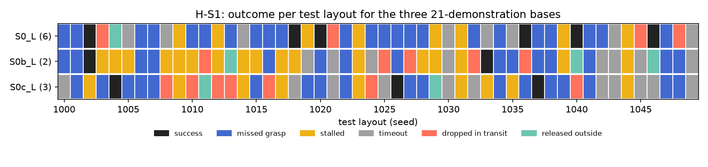

# H-S1: how and where does the base fail?

Plan S1 of RethoughtAI `training/sim_experiments.md` as written on 2026-10-20 (the plan's part 1,
since dropped from the plan; the runs were already done and serve as the noise floor of every other
report).

## Claim

**Hypothesis H-S1.** The three S0 bases fail on largely the same test layouts, in the same modes
(more than half of each base's failures shared by all three). **Null:** failures are independent
across seeds. **Expected outcome:** 40 to 70% success; failures concentrated in one or two modes and
in shared layouts. **Falsified if** the overlap of failed layouts across seeds is no larger than
chance.

## Conditions

| # | Base | What changed |
|---|---|---|
| S0 | VITA, episodes 0 to 20, training seed 0 | |
| S0b | same | training seed 1 |
| S0c | same | training seed 2 |

All 30k steps, the repository's VITA configuration with LeRobot's default image transforms, EMA
weights, run with the robot's runtime profile (32-step chunks, 16 run).

## Data and models

- Dataset: `andnetdeboer/BlueCupRedContainer_sim_lead640ms_train21@540eca6ef5fabde564ea8c7c23465f8bc1af1db0`
  (episodes 0 to 20 of `andnetdeboer/BlueCupRedContainer_sim_lead640ms@b16f755bce0795c50840bb92358d3815b13c046e`,
  8456 frames; pose labels led by 16 steps, 640 ms). Validation on
  `andnetdeboer/BlueCupRedContainer_sim_lead640ms_heldout5@87e641867722b79057199e2a894be761031960c2`.
- Models: `andnetdeboer/vita_BlueCupRedContainer_sim_lead640ms_train21_s0-ema`, `..._train21_s1-ema`,
  `..._train21_s2-ema`.

## Closed-loop results

50 test layouts (seeds 1000 to 1049), 40 s per attempt. Difference against S0 with the 95% bootstrap
interval over layouts, in layouts of 50; forgetting here is the change on the 6 layouts S0 solved.

| Condition | Success of 50 | Diff vs S0 [95%] | On S0's solved layouts | Median time (s) | Phase none/reach/grasp/transfer/release | Failure modes |
|---|---|---|---|---|---|---|
| S0 | 6 | | | 19.3 | 24/12/6/1/7 | missed grasp 23, timeout 8, stalled 8, dropped in transit 4, released outside 1 |
| S0b | 2 | -4.0 [-9.0, +0.0] | -0.83 | 22.2 | 18/20/5/2/5 | stalled 17, missed grasp 15, timeout 8, dropped in transit 5, released outside 3 |
| S0c | 3 | -3.0 [-9.0, +3.0] | -1.00 | 16.8 | 23/8/8/7/4 | missed grasp 18, timeout 11, stalled 9, dropped in transit 7, released outside 2 |

Phase none: the attempt never reached the cup.

## Overlap against chance

Chance is the same count with each base's outcomes permuted over layouts (20,000 permutations).

| Measure | Observed | Chance (mean) | p |
|---|---|---|---|
| Layouts failed by all three | 40 | 39.7 | 0.56 |
| Layouts solved by two or more | 1 (layout 1002) | 0.7 | 0.56 |
| Layouts with phase none in all three | 10 | 4.0 | 0.0004 |
| Of the 40 shared failures, same mode in all three | 15 | 3.4 | |
| Same mode, pairs S0/S0b, S0/S0c, S0b/S0c | 20, 18, 21 | 11.1, 12.0, 9.9 | |

The 40 shared failures are 91%, 83% and 85% of each base's failures, above the hypothesis's half, but
that is what chance gives at 88 to 96% failure. Ten different layouts were solved, only one of them
by two bases.

## Noise floor

Training seeds: 6, 2 and 3 of 50, a spread of 4 of 50. This is the base noise floor used by every
other report.

## Verdict: falsified

- The overlap of failed layouts is no larger than chance (40 against 39.7), which is the plan's
  falsification test. Which layouts a base solves is not shared across seeds.
- The expected outcome misses on success: 4 to 12%, not 40 to 70%.
- Partly as predicted: given that a layout fails, how it fails is shared well above chance (same mode
  in all three on 15 of 40 against 3.4; the same 10 layouts never reach the cup in all three, against
  4.0). Failures concentrate in missed grasps (15 to 23 per base) and stalls (8 to 17).

## Threats

- At 2 to 6 successes per base, overlap of failed layouts has almost no room to exceed chance; the
  test has little power at this success rate. The mode and phase agreement are the informative part.
- One draw of 50 test layouts; the per-layout failure mode comes from one 40 s attempt.
- The zero-lead bases trained earlier on the raw labels (S0 4, S0b 4, S0c 3 of 50) are superseded
  (see the README's label lead threat) and not used here.
