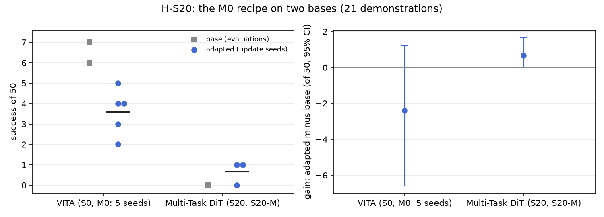

# H-S20: other bases

Plan S20 of RethoughtAI `training/sim_experiments.md` (part 4, does it generalise?): a recipe tied to
one architecture is a trick, so M0's recipe is moved from VITA to the 278 M Multi-Task DiT, a
diffusion policy with different internals.

## Claim

**Hypothesis H-S20.** The same recipe gives the DiT a gain within half of VITA's. **Null:** no gain on
the DiT. **Falsified if** S20-M's interval against S20 includes zero.

## Conditions

Gain is the adapted policy minus its own base, paired per layout.

| # | Base | Adapter | Trainable parameters | Loss | Corrected frames (gated at 3 cm) |
|---|---|---|---|---|---|
| S0 / M0 | VITA | LoRA rank 16 on the flow net's 8 linear layers | 327680 | VITA's flow loss | 363 |
| S20 / S20-M | Multi-Task DiT | LoRA rank 16 on the denoiser's attention qkv and out and MLP linears (24 linears) | 786432 | the DiT's own DDPM noise-prediction loss | 1263 |

Kept from M0 for S20-M: corrections from pool episodes 21, 25, 29, 33 wherever the base's plan is
more than 3 cm off the demonstration's chunk, anchor lambda 0.5 on the base's training episodes 0 to
20 (8456 frames), 200 steps, batch 256, learning rate 1e-4; the runtime loads the adapter at alpha 1.
Update seeds 0, 1, 2 for S20-M; M0 is taken over its five update seeds (0 to 4), see below.

The gate compares the demonstration's chunk with the base's own plan, so the number of corrected
frames follows the base: the DiT's plans are further from the demonstrations (open-loop error 49.0 mm
against VITA's 22.3 mm on the test episodes), and its gate passes 1263 frames (427, 244, 236, 356 from
the four pool episodes) against VITA's 363. It was not equalised.

S20 in this report is the DiT base trained with the 640 ms label lead, like every other base here.
Three DiT variants trained outside this plan on the same 21 demonstrations with modified training
(S20E 2 of 50, S20B 4, S20BE 1) are not plan conditions and are not used by the claim; they show the
same architecture can reach a few successes on this test.

## Data and models

- DiT base: `andnetdeboer/multi_task_dit_BlueCupRedContainer_sim_lead640ms_train21_s0` (Multi-Task
  DiT, episodes 0 to 20, training seed 0, 30k steps).
- VITA base: `andnetdeboer/vita_BlueCupRedContainer_sim_lead640ms_train21_s0-ema` (VITA, episodes 0 to
  20, training seed 0, 30k steps, EMA weights).
- Both trained on
  `andnetdeboer/BlueCupRedContainer_sim_lead640ms_train21@540eca6ef5fabde564ea8c7c23465f8bc1af1db0`.
- Corrections, anchor and open-loop episodes:
  `andnetdeboer/BlueCupRedContainer_sim_lead640ms@b16f755bce0795c50840bb92358d3815b13c046e`, pool
  episodes 21, 25, 29, 33; anchor episodes 0 to 20; open-loop test episodes 38 to 55.
- Adapters not published.

## Closed-loop results

50 test layouts, 40 s per attempt. Gain: adapted success averaged over update seeds per layout, minus
its base, 95% bootstrap interval over layouts, in layouts of 50. Forgetting: mean change on the
layouts the respective base solved.

| Condition | Success of 50 per seed | Mean | Gain vs own base [95%] | Forgetting | Median time (s) | Phase none/reach/grasp/transfer/release (pooled) | Failure modes (pooled) | Corrected frames | Update (s, GPU) |
|---|---|---|---|---|---|---|---|---|---|
| S0 (VITA) | 6; repeat 7 | 6.0 | | | 19.3 | 24/12/6/1/7 | missed grasp 23, timeout 8, stalled 8 | | |
| M0 (5 update seeds) | 4, 3, 2, 4, 5 | 3.6 | -2.4 [-6.6, +1.2] | -0.70 | 16.3 (seeds 0 to 2) | 90/20/22/6/12 (seeds 0 to 2) | missed grasp 77, stalled 21, timeout 20 (seeds 0 to 2) | 363 | 2.1, A100-SXM4-80GB |
| S20 (DiT) | 0 | 0.0 | | | | 38/3/8/1/0 | stalled 27, timeout 16, missed grasp 4 | | |
| S20-M | 1, 0, 1 | 0.7 | +0.7 [+0.0, +1.7] | (base solved none) | 26.7 | 112/12/20/1/5 | timeout 103, stalled 19, missed grasp 10 | 1263 | 25.0, A100-SXM4-80GB |

M0's gain over its three original update seeds, as the other reports use it, is -3.0 [-7.3, +0.7];
against the mean of S0's two evaluations (6 and 7) the five-seed gain is -2.9 [-6.6, +0.4]. S20's 0 of
50 was also seen in an earlier partial run (0 of 46 layouts). S20-M's two successes are on different
layouts (1006 for seed 0, 1041 for seed 2).

The plan's comparison, DiT gain against VITA gain (paired over layouts, in layouts of 50): DiT gain
minus VITA gain +3.1 [-0.7, +7.3] (M0 over three seeds: +3.7 [-0.3, +8.0]). The DiT base is below the
VITA base, -6.0 [-11.0, -2.0], and S20-M is below M0, -2.9 [-5.9, -0.4].

Cost: offline corrections from 4 pool episodes (no attempts). The DiT is slower to adapt: building
its latent cache took about 12 min (30 s to load, 676 s to encode 24055 frames of episodes 0 to 59,
28 ms per frame), the 200 update steps 25 s against about 2 s for VITA's M0 (more frames, a larger
denoiser), and each open-loop evaluation about 6 min (349 to 376 s per update seed), all on an
A100-SXM4-80GB.

## Open-loop results

Median per-episode path error (mm), alpha 1, mean over update seeds; in brackets the base's. The DiT
executes 24 steps of its 32-step chunk.

| Condition | Test episodes 38 to 55 | Base episodes 0 to 20, forgetting |
|---|---|---|
| M0 | 22.5 (22.3) | 6.7 (3.3) |
| S20-M | 50.5 (49.0) | 26.1 (10.9) |

On the DiT the adapter raises test error by 1.6 to 2.1 mm per seed (intervals include zero) and error
on the base's own episodes by about 13.7 mm per seed (intervals exclude zero): far more disturbance
than on VITA (+3.4 mm), with no open-loop gain on held-out episodes on either base.

## Noise floor

Base training seeds (VITA, 21 demonstrations): 6, 2, 3 of 50; the DiT has one training seed. M0's
five update seeds span 2 to 5; S20-M's three span 0 to 1. Repeat evaluations: S0 scored 6 and 7, M0's
seed 0 adapter 4 and 2. Any difference under about 4 of 50 is inside the floor.

## Verdict: falsified, degenerate

- By the plan's rule the claim is falsified: S20-M's interval against S20 includes zero (+0.7
  [+0.0, +1.7]); two successes in 150 attempts, on two different layouts, against a base at 0 of 50.
- The comparison is degenerate. The DiT base solves no layout, so its gain is measured from a floor:
  it cannot be negative and there is nothing to forget, while VITA's gain is measured from 6 of 50. And
  VITA's own gain, the quantity the hypothesis asks the DiT to reach half of, is not a gain: M0 over
  five update seeds is -2.4 [-6.6, +1.2] against its base. "Within half of VITA's gain" holds
  trivially for any non-negative DiT gain, so the hypothesis is not tested.
- The null (no gain on the DiT) is not rejected: +0.7 of 50 is far inside the noise floor. The DiT
  gain minus VITA's, +3.1 [-0.7, +7.3], includes zero and reflects VITA's loss more than a DiT gain.
- What the data show: the recipe moves to the DiT mechanically (same pool, gate, anchor, steps), but
  on this base it neither rescues the policy nor helps open loop, and it disturbs the base more than on
  VITA (13.7 against 3.4 mm on the base's own episodes). Timeouts replace stalls as the main failure
  (103 of 150 pooled against 16 of 50 for the base), and fewer attempts reach the cup (112 of 150 never
  get past the start, against 38 of 50).

## Threats

- The DiT base at 0 of 50 makes the claim untestable as posed: any measured DiT gain is bounded
  below by zero. A DiT base that solves some layouts (the DiT variants outside the plan reach 1 to 4 of 50) would
  be needed to compare gains, and forgetting, across architectures.
- The corrected frames are not matched: the gate passes 1263 frames on the DiT against 363 on VITA,
  and the DiT adapter has 2.4 times the trainable parameters. "Same recipe" fixes the procedure, not
  the size of the update.
- One DiT base (training seed 0) and three update seeds; the VITA side uses five update seeds of M0
  (the other reports use three) and a single S0 evaluation as the paired base (a repeat scored 7).
- M0 shows no gain over S0 (H-S9, H-S13, README), so the reference gain the claim scales against is
  itself within noise of zero or negative.
- All evaluations ran with the evaluator's per-layout random lighting, as for every condition; the
  closed loop is not deterministic.
