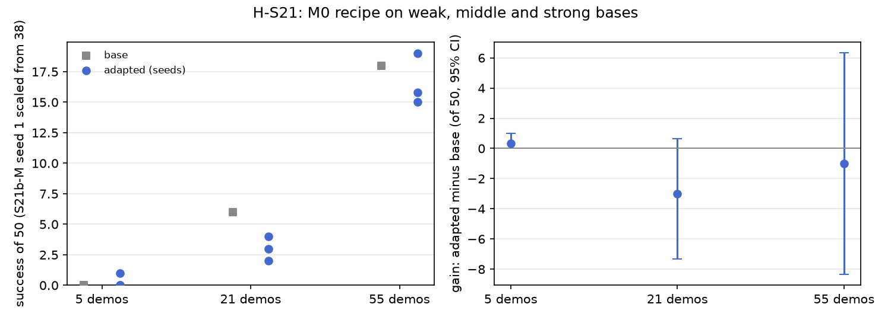

# H-S21: weak and strong bases

Plan S21 of RethoughtAI `training/sim_experiments.md` (part 4, does it generalise?).

## Claim

**Inquiry.** Does test-time training rescue a weak policy, or only polish a good one?
**Hypothesis H-S21.** The absolute gain is largest for the middle base: the weak one fails in too
many ways, the strong one in too few. **Null:** the gain shrinks steadily with base strength.
**Falsified if** S21a-M gains more than M0.

## Conditions

Gain is the adapted policy minus its own base, paired per layout.

| # | Base demonstrations | Then | Anchor episodes | Corrected frames (gated at 3 cm) |
|---|---|---|---|---|
| S21a / S21a-M | 5 (episodes 0 to 4) | M0's recipe | 0 to 4 (1965 frames) | 1404 |
| S0 / M0 | 21 (0 to 20) | M0's recipe | 0 to 20 (8456 frames) | 363 |
| S21b / S21b-M | 55 (0 to 54) | M0's recipe | 0 to 54 (22042 frames) | 14 |

M0's recipe: LoRA rank 16 on the flow net's 8 linear layers, corrections from pool episodes 21, 25,
29, 33 wherever the base's plan is more than 3 cm off the demonstration's chunk, anchor lambda 0.5 on
the base's own training episodes, 200 steps, batch 256, learning rate 1e-4, alpha 1. Update seeds 0,
1, 2. The gate is computed against each base, so the number of corrected frames follows its
strength; it was not equalised. S21b is the same model as S2c.

## Data and models

All from `andnetdeboer/BlueCupRedContainer_sim_lead640ms@b16f755bce0795c50840bb92358d3815b13c046e`
(pose labels led by 16 steps).

| Base | Dataset | Model |
|---|---|---|
| S21a | `andnetdeboer/BlueCupRedContainer_sim_lead640ms_train5@e3e1351df3c93cdd8be5394638f3165b4bff5daa` | `andnetdeboer/vita_BlueCupRedContainer_sim_lead640ms_train5_s0-ema` |
| S0 | `..._train21@540eca6ef5fabde564ea8c7c23465f8bc1af1db0` | `andnetdeboer/vita_BlueCupRedContainer_sim_lead640ms_train21_s0-ema` |
| S21b | `..._train55@97dcff3039af4533e05bf2a21e5d0d3b7412c150` | `andnetdeboer/vita_BlueCupRedContainer_sim_lead640ms_train55_s0-ema` |

All VITA, 30k steps, training seed 0, EMA weights. Adapters not published.

## Closed-loop results

50 test layouts, 40 s per attempt. Gain: adapted success averaged over update seeds per layout, minus
its base, 95% bootstrap interval over layouts, in layouts of 50. Forgetting: mean change on the
layouts the respective base solved.

| Condition | Success of 50 per seed | Mean | Gain vs own base [95%] | Forgetting | Median time (s) | Phase none/reach/grasp/transfer/release (pooled) | Failure modes (pooled) | Corrected frames | Update (s, GPU) |
|---|---|---|---|---|---|---|---|---|---|
| S21a (5) | 0 | 0.0 | | | | 46/3/1/0/0 | missed grasp 42, timeout 6, stalled 2 | | |
| S21a-M | 0, 0, 1 | 0.3 | +0.3 [+0.0, +1.0] | (base solved none) | 34.4 | 133/12/4/0/1 | missed grasp 96, timeout 42, stalled 9 | 1404 | 2.1, A100-SXM4-80GB |
| S0 (21) | 6 | 6.0 | | | 19.3 | 24/12/6/1/7 | missed grasp 23, timeout 8, stalled 8 | | |
| M0 | 4, 3, 2 | 3.0 | -3.0 [-7.3, +0.7] | -0.72 | 16.3 | 90/20/22/6/12 | missed grasp 77, stalled 21, timeout 20 | 363 | 2.1, A100-SXM4-80GB |
| S21b (55) | 18 | 18.0 | | | 13.9 | 6/15/8/2/19 | missed grasp 17, dropped in transit 6, stalled 6 | | |
| S21b-M (partial) | 19, 12 of 38, 15 | 15.3 | -1.0 [-8.3, +6.3] | -0.53 | 13.0 | 17/42/24/2/53 | missed grasp 54, dropped in transit 20, released outside 9 | 14 | 2.2, A100-PCIE-40GB |

**S21b-M is partial:** seed 1 has 38 of 50 layouts (a rerun is pending). Its mean uses the available
seeds per layout. On the 38 layouts seed 1 covers, the three seeds score 14, 12, 10 and S21b scores
13.

Differences between gains (paired per layout, 95% interval): S21a-M minus M0 +3.3 [-0.7, +8.0];
S21b-M minus M0 +2.0 [-6.2, +10.2]; S21a-M minus S21b-M +1.3 [-6.0, +8.7].

Cost: offline corrections from 4 pool episodes (no attempts); update compute on cached latents on a
cluster GPU.

## Open-loop results

Median per-episode path error (mm), alpha 1, mean over update seeds; in brackets the base's.

| Condition | Test episodes 38 to 55 | Episodes 0 to 20 |
|---|---|---|
| S21a-M | 77.2 (73.2) | 84.5 (82.0) |
| M0 | 22.5 (22.3) | 6.7 (3.3) |
| S21b-M | 4.0 (3.4) | 2.9 (2.2) |

The adapter raises open-loop error slightly on every base.

## Noise floor

Base training seeds at 21 demonstrations: 6, 2, 3 of 50. The 5 and 55 demonstration bases have one
training seed each. S21b-M's update seeds span 15 to 19 on full seeds.

## Verdict: inconclusive

- No base gains beyond noise: +0.3 (weak), -3.0 (middle), -1.0 (strong, partial).
- The hypothesis predicts the middle base gains most; it gains least. S21a-M gains more than M0 in
  the mean (+0.3 against -3.0), which is the falsification test, but the difference between the gains
  is +3.3 [-0.7, +8.0], an interval that includes zero and a difference inside the noise floor, so it
  does not count.
- The null (gain shrinks with strength) is not supported either: the gains are not ordered.
- The weak base is not rescued: one success in 150 attempts, and 133 of 150 attempts still never
  reach the cup.

## Threats

- S21b-M is partial (seed 1 at 38 of 50); the conclusion does not depend on it, since its full seeds
  (19, 15) bracket the base's 18.
- The corrected frames are not matched: the gate passes 1404 frames on the 5-demonstration base and
  14 on the 55-demonstration base, whose training set contains the pool episodes 21, 25, 29, 33. S21b-M
  is close to an anchor-only update; it measures little more than the update's disturbance.
- Open-loop figures: episodes 0 to 20 are mostly held out for S21a (trained on 0 to 4), and S21b's
  training set contains the test episodes 38 to 54, so its open-loop errors are training errors.
- M0 itself shows no gain over S0 (H-S9, H-S13), so the middle point of the curve is a loss, and the
  comparison the plan makes (where is the gain largest) has no gain to place.
