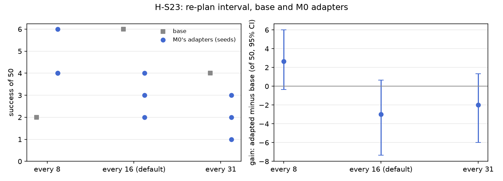

# H-S23: how much of each chunk to run

Plan S23 of RethoughtAI `training/sim_experiments.md` (part 4, does it generalise?): running a long
chunk ignores new observations, and a correction can only act at the next re-plan, so the adapter's
effect may depend on how often the policy re-plans.

## Claim

**Hypothesis H-S23.** The adapter's gain is larger when the policy re-plans more often (8). **Null:**
the gain does not depend on the chunk run. **Falsified if** the gain at 8 is within noise of the gain
at 16.

## Conditions

The same base and the same adapters (M0's, update seeds 0, 1, 2), run with three runtime settings. Only
the runtime's re-plan interval changes: the policy plans a chunk of 32 steps (25 Hz) and a new plan
replaces the old one every N steps; all 32 targets are still published and the latest plan wins.

| # | Re-plan every (steps of the 32-step chunk) | Base | Adapted |
|---|---|---|---|
| S23a / S23a-M | 8 (0.32 s) | S0 | S0 with M0's adapters |
| S0 / M0 | 16 (0.64 s), the runtime's default | S0 | S0 with M0's adapters |
| S23b / S23b-M | 31 (1.24 s); the plan asks for 32 | S0 | S0 with M0's adapters |

**Deviation:** the plan's S23b runs the whole chunk (every 32). The runtime rejects 32, because the
re-plan interval must be below the executable chunk length of 32, so S23b and S23b-M re-plan every
31 steps, the longest run the runtime allows. Gain is the adapted policy minus the base at the same
interval, paired per layout.

M0's adapters: LoRA rank 16 on the flow net's 8 linear layers, corrections from pool demonstrations
21, 25, 29, 33 gated at 3 cm (363 frames), anchor lambda 0.5 on episodes 0 to 20, 200 steps, batch
256, learning rate 1e-4, alpha 1. No new update was trained for this claim.

## Data and models

- Base: `andnetdeboer/vita_BlueCupRedContainer_sim_lead640ms_train21_s0-ema` (VITA, episodes 0 to 20,
  training seed 0, 30k steps), trained on
  `andnetdeboer/BlueCupRedContainer_sim_lead640ms_train21@540eca6ef5fabde564ea8c7c23465f8bc1af1db0`.
- Corrections, anchor and open-loop episodes (M0's):
  `andnetdeboer/BlueCupRedContainer_sim_lead640ms@b16f755bce0795c50840bb92358d3815b13c046e`.
- Adapters not published.

## Closed-loop results

50 test layouts, 40 s per attempt. Difference: success averaged over the three update seeds per
layout, minus the base's at the default interval (S0), 95% bootstrap interval over layouts, in layouts
of 50. Forgetting: mean change in success on the 6 layouts S0 solved (minus 1: all lost).

| Condition | Success of 50 per seed | Mean | Diff vs S0 [95%] | Forgetting | Solved layouts lost per seed (of 6) | Median time (s) | Phase none/reach/grasp/transfer/release (pooled) | Failure modes (pooled) | Corrected frames | Update (s, GPU) |
|---|---|---|---|---|---|---|---|---|---|---|
| S23a (base, every 8) | 2 | 2.0 | -4.0 [-9.0, +0.0] | -0.83 | 5 | 15.6 | 22/16/9/1/2 | missed grasp 24, stalled 14, dropped in transit 5 | | |
| S0 (base, every 16) | 6 | 6.0 | | | | 19.3 | 24/12/6/1/7 | missed grasp 23, timeout 8, stalled 8 | | |
| S23b (base, every 31) | 4 | 4.0 | -2.0 [-8.0, +3.0] | -0.83 | 5 | 18.4 | 15/17/12/2/4 | missed grasp 15, timeout 14, dropped in transit 6 | | |
| S23a-M (M0's adapters, every 8) | 6, 4, 4 | 4.7 | -1.3 [-6.3, +3.0] | -0.78 | 5, 5, 4 | 16.8 | 99/15/16/3/17 | missed grasp 68, stalled 41, timeout 14 | 363 (M0's) | (M0's) |
| M0 (every 16) | 4, 3, 2 | 3.0 | -3.0 [-7.3, +0.7] | -0.72 | 4, 4, 5 | 16.3 | 90/20/22/6/12 | missed grasp 77, stalled 21, timeout 20 | 363 | 2.1, A100-SXM4-80GB |
| S23b-M (M0's adapters, every 31) | 2, 3, 1 | 2.0 | -4.0 [-8.3, -0.3] | -0.78 | 4, 4, 6 | 14.7 | 57/59/27/0/7 | missed grasp 93, timeout 20, dropped in transit 15 | 363 (M0's) | (M0's) |

The plan's comparison, gain of the adapters over the base at the same interval (paired over layouts,
in layouts of 50):

| Re-plan every | Base | Adapted (mean of 3 seeds) | Gain [95%] | Base's solved layouts | Forgetting against that base |
|---|---|---|---|---|---|
| 8 | 2 | 4.7 | +2.7 [-0.3, +6.0] | 2 | -0.50 |
| 16 (default) | 6 | 3.0 | -3.0 [-7.3, +0.7] | 6 | -0.72 |
| 31 | 4 | 2.0 | -2.0 [-6.0, +1.3] | 4 | -0.83 |

Differences between gains, paired over layouts: gain at 8 minus gain at 16 +5.7 [+1.3, +10.3]; at 31
minus at 16 +1.0 [-5.0, +6.7]; at 8 minus at 31 +4.7 [+0.3, +9.3]. Where the difference at 8 comes
from: the adapted policy at 8 against M0 +1.7 [-1.0, +4.3], the base at 8 against S0 -4.0 [-9.0,
+0.0].

Cost: none beyond M0's (the same adapters, 363 corrected frames, about 2 s of update compute); the
interval only changes how often the runtime plans.

## Open-loop results

Not applicable: the adapters are M0's, and the re-plan interval only acts closed loop. M0's open-loop
errors (test episodes 22.5 mm against the base's 22.3, base episodes 6.7 against 3.3) hold for every
interval.

## Noise floor

Base training seeds: 6, 2, 3 of 50. M0's update seeds: 4, 3, 2; S23a-M's 4 to 6, S23b-M's 1 to 3. Each
base interval is a single evaluation, and the closed loop is not deterministic (bit-identical
adapters elsewhere scored 2, 2, 2 and 1, 3, 3). Any difference under about 4 of 50 is inside the
floor.

## Verdict: supported, weakly

- By the plan's rule the claim stands: the gain at 8 (+2.7) exceeds the gain at 16 (-3.0) by +5.7
  [+1.3, +10.3], an interval that excludes zero and a difference above the noise floor of about 4. The
  gain at 8 also exceeds the gain at 31 (+4.7 [+0.3, +9.3]); 31 and 16 do not differ (+1.0 [-5.0,
  +6.7]).
- The support is weak. The gain at 8 is not itself above zero ([-0.3, +6.0]), and most of the
  difference comes from the base, not the adapters: the base re-planning every 8 scores 2 of 50
  against S0's 6 (-4.0 [-9.0, +0.0]), while the adapted policy at 8 is within noise of M0 (+1.7 [-1.0,
  +4.3]). Both bases are single evaluations, and S0's 6 is the top of the training-seed spread (6, 2,
  3), so a base draw alone could account for much of the gap.
- What the data do show: with re-planning every 8 steps M0's adapters are no worse than the base
  (4.7 against 2), and S23a-M is the best adapted condition here, while at 16 and 31 the adapters lose
  against their base. Stalls rise with the adapters at 8 (41 pooled, against 14 for its base), so the
  adapted policy at 8 still fails differently from the base.

## Threats

- **Deviation:** S23b re-plans every 31 steps, not 32 as planned, because the runtime requires the
  interval to be below the 32-step executable chunk. One step (40 ms) of the chunk is left unrun; the
  comparison of a long against a short run stands, the exact full-chunk condition was not run.
- The gains rest on single base evaluations at 8 and 31 and on S0's 6; a second base evaluation at
  each interval, or the other training seeds, would test whether the base's drop at 8 is real.
- M0 may be a low draw (several conditions sit about 3 of 50 above it but only at the base's level),
  which lowers the gain at 16 that the gain at 8 is compared with.
- The adapters were trained once, at no particular interval; corrections are chunks gated against
  the base's plan, independent of the runtime. The claim is about running the same adapter differently,
  not about adapters trained for an interval.
- Forgetting against S0's solved layouts mixes the interval's effect on the base with the adapter's;
  against each interval's own base it rests on 2 (every 8) and 4 (every 31) solved layouts.
- One base (training seed 0). All evaluations ran with the evaluator's per-layout random lighting, as
  for every condition.
