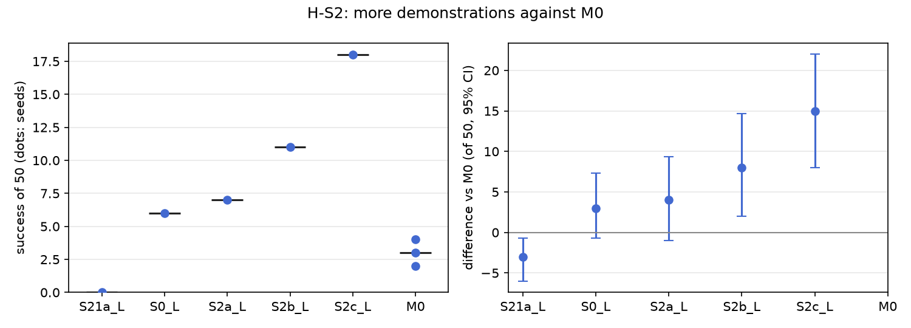

# H-S2: is it just a lack of data?

Plan S2 of RethoughtAI `training/sim_experiments.md` as written on 2026-10-20 (the plan's part 1,
since dropped from the plan; the bases were already trained and evaluated).

## Claim

**Hypothesis H-S2.** Adapting S0 with corrections from 4 episodes raises success more than retraining
the base with those 4 episodes as whole demonstrations, and as much as retraining with 16 more.
**Null:** extra demonstrations match or beat corrections at equal episodes. **Expected outcome:** M0
above S2a, close to S2b; S2c above M0 but at 34 more demonstrations. **Falsified if** S2a matches M0.

## Conditions

The plan names S2a, S2b, S2c and M0. S21a (5 demonstrations) and S0 (21) are added to show the
whole demonstration count curve.

| # | Base demonstrations | What changed against S0 |
|---|---|---|
| S21a | 5 (episodes 0 to 4) | training episodes |
| S0 | 21 (0 to 20) | |
| S2a | 25 (0 to 20 plus 21, 25, 29, 33) | the 4 pool episodes M0 corrects from, added as whole demonstrations |
| S2b | 37 (0 to 36) | training episodes |
| S2c | 55 (0 to 54) | training episodes |
| M0 | S0 plus a LoRA adapter (rank 16, flow net), corrections from 21, 25, 29, 33 (363 frames), anchor 0.5 on episodes 0 to 20, 200 steps | the adapter |

Every base: VITA, 30k steps, training seed 0, EMA weights, robot runtime profile. M0: update seeds 0,
1, 2.

## Data and models

All subsets of `andnetdeboer/BlueCupRedContainer_sim_lead640ms@b16f755bce0795c50840bb92358d3815b13c046e`
(pose labels led by 16 steps), validated on `..._heldout5@87e641867722b79057199e2a894be761031960c2`.

| # | Dataset | Model |
|---|---|---|
| S21a | `andnetdeboer/BlueCupRedContainer_sim_lead640ms_train5@e3e1351df3c93cdd8be5394638f3165b4bff5daa` (1965 frames) | `andnetdeboer/vita_BlueCupRedContainer_sim_lead640ms_train5_s0-ema` |
| S0, M0 | `..._train21@540eca6ef5fabde564ea8c7c23465f8bc1af1db0` (8456 frames) | `andnetdeboer/vita_BlueCupRedContainer_sim_lead640ms_train21_s0-ema` |
| S2a | `..._train25@eb663a31eaa1b8d9608f6ef8684ca91435475a9c` (10142 frames) | `andnetdeboer/vita_BlueCupRedContainer_sim_lead640ms_train25_s0-ema` |
| S2b | `..._train37@59fab57771941cb19ec5f7af5da3582d5527a24e` (15017 frames) | `andnetdeboer/vita_BlueCupRedContainer_sim_lead640ms_train37_s0-ema` |
| S2c | `..._train55@97dcff3039af4533e05bf2a21e5d0d3b7412c150` | `andnetdeboer/vita_BlueCupRedContainer_sim_lead640ms_train55_s0-ema` |

M0's adapters were not published.

## Closed-loop results

50 test layouts, 40 s per attempt. Difference against M0 (M0 averaged over its three update seeds per
layout), 95% bootstrap interval over layouts, in layouts of 50. Forgetting: change on the 6 layouts S0
solved.

| Condition | Success of 50 | Diff vs M0 [95%] | Diff vs S0 [95%] | Forgetting | Median time (s) | Phase none/reach/grasp/transfer/release | Failure modes | Corrected frames | Update (s, GPU) |
|---|---|---|---|---|---|---|---|---|---|
| S21a (5) | 0 | -3.0 [-6.0, -0.7] | -6.0 [-11.0, -2.0] | -1.00 | | 46/3/1/0/0 | missed grasp 42, timeout 6, stalled 2 | | |
| S0 (21) | 6 | +3.0 [-0.7, +7.3] | | | 19.3 | 24/12/6/1/7 | missed grasp 23, timeout 8, stalled 8 | | |
| S2a (25) | 7 | +4.0 [-1.0, +9.3] | +1.0 [-5.0, +7.0] | -0.67 | 16.9 | 18/12/7/4/9 | missed grasp 17, stalled 10, dropped in transit 9 | | |
| S2b (37) | 11 | +8.0 [+2.0, +14.7] | +5.0 [-2.0, +12.0] | -0.67 | 16.3 | 15/14/6/2/13 | missed grasp 20, stalled 7, dropped in transit 7 | | |
| S2c (55) | 18 | +15.0 [+8.0, +22.0] | +12.0 [+5.0, +20.0] | -0.50 | 13.9 | 6/15/8/2/19 | missed grasp 17, dropped in transit 6, stalled 6 | | |
| M0 | 4, 3, 2 (mean 3.0) | | -3.0 [-7.3, +0.7] | -0.72 | 16.3 | 90/20/22/6/12 (pooled) | missed grasp 77, stalled 21, timeout 20 (pooled) | 363 | 2.1, A100-SXM4-80GB |

Cost: M0 needs 4 recorded episodes and 2.1 s of update on cached latents; each base is a 30k-step
training run (the same configuration took 1 h 08 min on an H100 for S4, see H-S4), plus recording the
extra episodes. Attempts: none for either (offline).

## Open-loop results

Not asked by this plan. M0: median path error 22.5 mm on test episodes 38 to 55 (base 22.3), 6.7 mm
on episodes 0 to 20 (base 3.3).

## Noise floor

Base training seeds at 21 demonstrations: 6, 2, 3 of 50. M0's update seeds: 4, 3, 2. Each S2 base
has one training seed.

## Verdict: falsified

- S2a, with the 4 pool episodes as whole demonstrations, is at least M0: 7 against 3.0 of 50,
  difference +4.0 [-1.0, +9.3]. It matches M0 (the falsification test) and lies above it in the mean.
- M0 does not raise success at all (-3.0 against S0), so it does not reach S2b (11, +8.0 [+2.0,
  +14.7] above M0) or S2c (18, +15.0 [+8.0, +22.0] above M0).
- Success rises with the number of demonstrations: 0, 6, 7, 11, 18 at 5, 21, 25, 37, 55, and the
  share of attempts that never reach the cup falls from 46 to 6 of 50.

## Threats

- One training seed per base; the 21-demonstration seeds span 2 to 6, so S2a against S0 (+1) is
  inside the floor. S2b and S2c are beyond it.
- S2c's 55 episodes include the open-loop test episodes 38 to 54 and the pool episodes; this affects
  only open-loop metrics, not the closed-loop test layouts.
- More demonstrations cost recording time (whole episodes) that M0 does not need; the plan compares
  at equal episodes, not at equal operator minutes.
