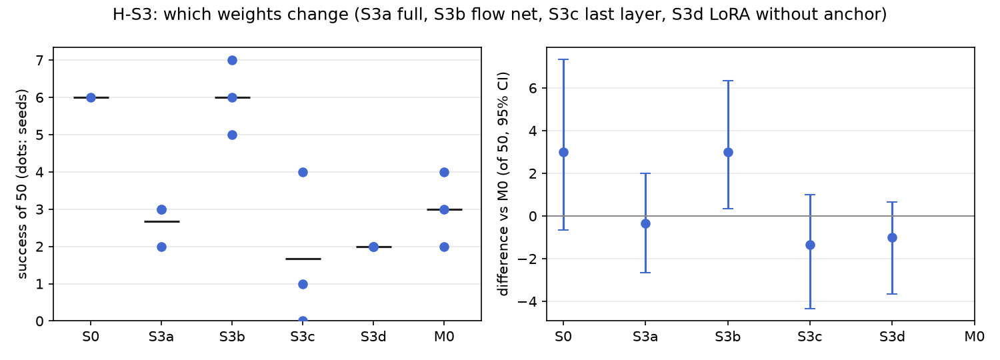

# H-S3: which weights should change?

Plan S3 of RethoughtAI `training/sim_experiments.md` (part 1, against what? the alternatives,
simplest first).

## Claim

**Hypothesis H-S3.** LoRA with the anchor (M0) matches full fine-tuning on the test layouts and
forgets less; last-layer-only fixes less. **Null:** full fine-tuning is clearly better. **Expected
outcome:** S3a and S3b at most M0's gain, with more forgetting; S3c below M0; S3d close to M0 on gain,
worse on forgetting. **Falsified if** S3a or S3b beats M0 beyond noise with no more forgetting.

## Conditions

Every condition is M0 with one change, the trainable set (and with it the loss where the flow error
alone cannot reach the trained weights).

| # | Trainable | Trainable parameters | Anchor lambda | Loss |
|---|---|---|---|---|
| S3a | everything after the frozen image backbone: observation encoder, flow net, action decoder, every weight | 15,892,736 | 0.5 | the base's training objective (flow error plus its consistency and reconstruction terms) |
| S3b | the whole flow net, every weight | 12,865,024 | 0.5 | flow error |
| S3c | the flow net's output layer only | 262,656 | 0.5 | flow error |
| S3d | LoRA rank 16 on the flow net, no anchor | 327,680 | 0 | flow error |
| M0 | LoRA rank 16 on the flow net | 327,680 | 0.5 | flow error |

S3a keeps the image backbone and the action encoder frozen so that it runs on the same cached latents
as the others; the reconstruction terms are needed because the flow error does not reach the decoder.
S3d is the same configuration as S10a (lambda 0); its adapters are bit-identical to S10a's, evaluated
again in a separate run.

Kept from M0: the 3 cm gate, corrections from pool episodes 21, 25, 29, 33 (363 corrected frames),
anchor episodes 0 to 20 (8456 frames, none for S3d), 200 steps, batch 256, learning rate 1e-4, alpha 1
(for S3a to S3c, alpha blends the base's and the tuned weights). Update seeds 0, 1, 2.

## Data and models

- Base: `andnetdeboer/vita_BlueCupRedContainer_sim_lead640ms_train21_s0-ema` (VITA, episodes 0 to 20,
  training seed 0, 30k steps), trained on
  `andnetdeboer/BlueCupRedContainer_sim_lead640ms_train21@540eca6ef5fabde564ea8c7c23465f8bc1af1db0`.
- Corrections, anchor and open-loop episodes:
  `andnetdeboer/BlueCupRedContainer_sim_lead640ms@b16f755bce0795c50840bb92358d3815b13c046e`, pool
  episodes 21, 25, 29, 33; anchor episodes 0 to 20; open-loop test episodes 38 to 55.
- Adapters not published.

## Closed-loop results

50 test layouts, 40 s per attempt. Difference: success averaged over the three update seeds per
layout, minus M0's, 95% bootstrap interval over layouts, in layouts of 50. Forgetting: mean change in
success on the 6 layouts the base solved (minus 1: all lost).

| Condition | Success of 50 per seed | Mean | Diff vs M0 [95%] | Forgetting | Solved layouts lost per seed (of 6) | Median time (s) | Phase none/reach/grasp/transfer/release (pooled) | Failure modes (pooled) | Corrected frames | Update (s, GPU) |
|---|---|---|---|---|---|---|---|---|---|---|
| S0 (base) | 6 | 6.0 | +3.0 [-0.7, +7.3] | | | 19.3 | 24/12/6/1/7 | missed grasp 23, timeout 8, stalled 8 | | |
| S3a (everything) | 3, 3, 2 | 2.7 | -0.3 [-2.7, +2.0] | -0.67 | 4, 4, 4 | 21.4 | 97/16/23/4/10 | missed grasp 71, stalled 37, dropped in transit 22 | 363 | 12.6, A100-PCIE-40GB |
| S3b (flow net) | 5, 6, 7 | 6.0 | +3.0 [+0.3, +6.3] | -0.67 | 5, 3, 4 | 17.6 | 85/27/19/1/18 | missed grasp 66, stalled 44, dropped in transit 13 | 363 | 2.1, A100-SXM4-80GB |
| S3c (last layer) | 0, 4, 1 | 1.7 | -1.3 [-4.3, +1.0] | -0.94 | 6, 5, 6 | 17.5 | 96/21/27/0/6 | missed grasp 91, stalled 22, dropped in transit 16 | 363 | 1.1, A100-SXM4-80GB |
| S3d (LoRA, no anchor) | 2, 2, 2 | 2.0 | -1.0 [-3.7, +0.7] | -0.94 | 6, 6, 5 | 21.9 | 120/5/16/2/7 | missed grasp 79, stalled 27, timeout 26 | 363 | 3.2, A100-SXM4-80GB |
| M0 (LoRA, anchor) | 4, 3, 2 | 3.0 | | -0.72 | 4, 4, 5 | 16.3 | 90/20/22/6/12 | missed grasp 77, stalled 21, timeout 20 | 363 | 2.1, A100-SXM4-80GB |

Success on the 6 solved layouts against M0 (layouts of 6, 95% interval): S3a +0.33 [-1.00, +2.00],
S3b +0.33 [-1.33, +2.00], S3c -1.33 [-3.33, +0.00], S3d -1.33 [-3.33, +0.00].

Update compute is the wall time of the 200 steps on cached latents on a cluster GPU (S3a on
A100-PCIE-40GB, the others on A100-SXM4-80GB); attempts: none (offline corrections).

## Open-loop results

Median per-episode path error (mm), alpha 1, mean over the three update seeds.

| Condition | Test episodes 38 to 55 (base 22.3) | Base episodes 0 to 20, forgetting (base 3.3) |
|---|---|---|
| S3a (everything) | 22.4 | 4.3 |
| S3b (flow net) | 22.3 | 4.6 |
| S3c (last layer) | 24.7 | 12.2 |
| S3d (LoRA, no anchor) | 27.9 | 15.6 |
| M0 | 22.5 | 6.7 |

## Noise floor

Base training seeds: 6, 2, 3 of 50. Update seeds within one condition span up to 4 of 50 (S3c: 0 to
4). The evaluation itself is not deterministic: S3d's adapters are bit-identical to S10a's and score
2, 2, 2 against 1, 3, 3 in a separate evaluation (7 of 150 layout outcomes differ; difference -0.3
[-2.3, +1.3]). Any difference under about 4 of 50 is inside the floor.

## Verdict: inconclusive

- Not falsified: S3b (the whole flow net) is above M0 with an interval that excludes zero (+3.0
  [+0.3, +6.3]) and forgets no more (-0.67 against -0.72), but the difference is under the noise floor
  of about 4 of 50, so it does not count as beyond noise under the plan's rule. S3a (everything) is
  level with M0 (-0.3 [-2.7, +2.0]).
- The null (full fine-tuning clearly better) is not supported: S3a is not better, and S3b only reaches
  the base's level (6.0 against 6, +0.0 [-5.0, +4.3] against the base).
- The forgetting part of the hypothesis fails: LoRA with the anchor does not forget less than full
  fine-tuning, closed loop (-0.72 against -0.67 for both) or open loop (6.7 mm on the base's episodes
  against 4.3 and 4.6 mm). With the same anchor, the many-parameter updates stay closer to the base.
- The other predictions hold in direction but within noise: S3c (last layer) is below M0 (1.7, -1.3
  [-4.3, +1.0]) and forgets more (-0.94, 12.2 mm); S3d (no anchor) is close to M0 on success (2.0)
  and worse on forgetting (-0.94 against -0.72, 15.6 against 6.7 mm), as in H-S10.
- No trainable set gains over the base (best 6.0 against 6). S3b's lead over M0 has the same size as
  S13a's and S13b's, which fits M0's three seeds being a low draw.

## Threats

- M0 (3.0) may be a low draw: S3b, S13a, S13b, S5 and S8a all sit about 3 of 50 above it with
  intervals that exclude zero, at the base's level. Every comparison against M0 shares that offset.
- S3a uses a different loss (with reconstruction and consistency terms) than the flow-net-only
  conditions; its result mixes the trainable set and the loss.
- Forgetting rests on the 6 layouts the base solved; one layout moves it by 0.17.
- All conditions share the 363 corrected frames from 4 pool demonstrations and one base (training
  seed 0). All evaluations ran with the evaluator's per-layout random lighting, as for every
  condition.
