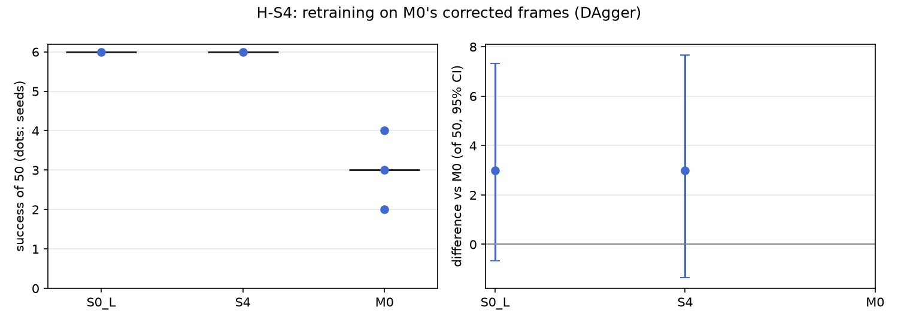

# H-S4: retraining with the corrections (DAgger)

Plan S4 of RethoughtAI `training/sim_experiments.md` (part 1, against what? The alternatives).

## Claim

**Inquiry.** DAgger aggregates the corrected states into the dataset and retrains from scratch: the
strongest data-centric baseline, at full training cost.
**Hypothesis H-S4.** Retraining on base plus corrected frames reaches M0's success but costs about
100 times its compute and forgets no less. **Null:** retraining is clearly better. **Expected
outcome:** S4 within noise of M0 on success, at about 100 times the update compute. **Falsified if**
S4 is clearly above M0.

## Conditions

| # | Condition | What changed against M0 |
|---|---|---|
| M0 | S0 plus a LoRA adapter (rank 16, flow net), 363 corrected frames from pool episodes 21, 25, 29, 33 (gate 3 cm), anchor 0.5 on episodes 0 to 20, 200 steps, batch 256, learning rate 1e-4 | |
| S4 | VITA retrained from scratch, 30k steps, training seed 0, on episodes 0 to 20 plus M0's corrected frames | no adapter; the corrections become training data |

The corrected frames are exactly M0's (same gate on the same base, same pool episodes). With the
offline corrector a frame's correction is the demonstration's own chunk from that frame, so each run
of consecutive corrected frames was exported as one episode with the 31 frames after it (the chunk
the frame trains on): 10 segments, 714 frames, of which 363 are corrected frames. One training seed;
S4 is a single model, so it has no update seeds.

## Data and models

- S4 dataset: `andnetdeboer/BlueCupRedContainer_sim_lead640ms_train21_dagger@afeb50e0388c5df1895465d7300e9c7eeb6ed216`
  (train21's 21 episodes unchanged plus the 10 segments).
- Sources: `andnetdeboer/BlueCupRedContainer_sim_lead640ms_train21@540eca6ef5fabde564ea8c7c23465f8bc1af1db0`,
  `andnetdeboer/BlueCupRedContainer_sim_lead640ms@b16f755bce0795c50840bb92358d3815b13c046e` (pool
  episodes 21, 25, 29, 33). Validation on `..._heldout5@87e641867722b79057199e2a894be761031960c2`.
- Models: S4 `andnetdeboer/vita_BlueCupRedContainer_sim_lead640ms_train21_dagger_s0-ema` (EMA weights
  evaluated); base `andnetdeboer/vita_BlueCupRedContainer_sim_lead640ms_train21_s0-ema`. M0's
  adapters not published.

## Closed-loop results

50 test layouts, 40 s per attempt. Difference: against M0 averaged over its three update seeds per
layout, 95% bootstrap interval over layouts, in layouts of 50. Forgetting: mean change on the 6
layouts the base solved.

| Condition | Success of 50 per seed | Mean | Diff vs M0 [95%] | Diff vs S0 [95%] | Forgetting | Median time (s) | Phase none/reach/grasp/transfer/release | Failure modes | Corrected frames | Compute |
|---|---|---|---|---|---|---|---|---|---|---|
| S0 (base) | 6 | 6.0 | +3.0 [-0.7, +7.3] | | | 19.3 | 24/12/6/1/7 | missed grasp 23, timeout 8, stalled 8 | | |
| S4 | 6 | 6.0 | +3.0 [-1.3, +7.7] | +0.0 [-6.0, +5.0] | -0.67 | 16.4 | 23/11/8/2/6 | missed grasp 19, stalled 13, timeout 6 | 363 (714 frames added) | 1 h 08 min (4080 s), H100 80GB |
| M0 | 4, 3, 2 | 3.0 | | -3.0 [-7.3, +0.7] | -0.72 | 16.3 | 90/20/22/6/12 (pooled) | missed grasp 77, stalled 21, timeout 20 (pooled) | 363 | 2.1 s, A100-SXM4-80GB |

S4 loses 4 of the 6 layouts the base solved (M0's seeds lose 4, 4, 5) and solves 4 others; success on
the 6 against M0: +0.33 [-2.67, +3.33] layouts of 6.

Cost: S4's compute is the wall time of the 30k-step retraining on one H100 (including evaluation on
the held-out set every 2000 steps); M0's is 200 update steps on cached latents. The ratio is about
1900 times (4080 s against 2.1 s; the GPUs differ, so this is an order of magnitude only). Both use the
same 4 recorded episodes and no attempts.

## Open-loop results

Not computed for S4 (the open-loop tool scores adapters against their base). M0: 22.5 mm on test
episodes 38 to 55 (base 22.3), 6.7 mm on episodes 0 to 20 (base 3.3).

## Noise floor

Base training seeds: 6, 2, 3 of 50; S4 is one retraining at training seed 0 and varies at least as
much. M0's update seeds: 4, 3, 2.

## Verdict: supported

- S4 is within noise of M0: 6 against 3.0 of 50, +3.0 [-1.3, +7.7], an interval that includes zero.
  It is not clearly above M0, so the hypothesis is not falsified and the null is not supported.
- It costs far more than predicted: about 1900 times M0's update compute, not 100.
- It forgets no less: -0.67 against -0.72 on the base's 6 solved layouts.
- Neither method improves on the base: S4 equals S0 (6, +0.0 [-6.0, +5.0]), M0 is below it.

## Threats

- One training seed: retraining from scratch reshuffles which layouts succeed as much as a new base
  seed does (base seeds 6, 2, 3, with solved layouts barely shared, see H-S1). S4's "forgetting" is
  that reshuffle, not damage from the corrections.
- 363 corrected frames (714 with their chunk tails) are 8% of a 9170-frame training set; the retrained
  base sees them as little more than 4 extra partial demonstrations.
- Compute is cluster wall time on an H100, against M0's on an A100; neither is the robot computer.
