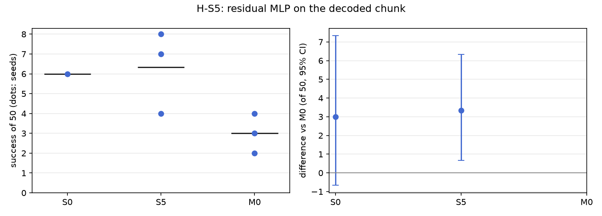

# H-S5: a residual policy

Plan S5 of RethoughtAI `training/sim_experiments.md` (part 1, against what? the alternatives,
simplest first).

## Claim

**Hypothesis H-S5.** A residual MLP on the action chunk, trained on the same corrections, fixes less
than M0, because the failure is in which chunk is chosen, not in its fine shape. **Null:** the residual
matches M0. **Expected outcome:** S5 below M0; its gain mostly in grasp precision, not in failures of
the wrong phase. **Falsified if** S5 matches or beats M0.

## Conditions

| # | What learns | Trainable parameters | Loss |
|---|---|---|---|
| M0 | LoRA rank 16 on the flow net's 8 linear layers | 327,680 | flow error on the corrected latents, anchor on base pairs |
| S5 | a residual MLP (one hidden layer, 319 units) from the base's decoded chunk and the observation latent z0 to a correction added to the chunk; the whole policy frozen | 327,231 | the checkpoint's reconstruction loss over the normalised chunk: base chunk plus correction against the corrector's chunk on corrected frames, and the correction against zero on anchor frames |

The hidden width is chosen so that S5 has M0's parameter count. Alpha scales the head's output (1
here).

Kept from M0: the 3 cm gate, corrections from pool episodes 21, 25, 29, 33 (363 corrected frames),
anchor lambda 0.5 on episodes 0 to 20 (8456 frames), 200 steps, batch 256, learning rate 1e-4,
alpha 1. Update seeds 0, 1, 2.

## Data and models

- Base: `andnetdeboer/vita_BlueCupRedContainer_sim_lead640ms_train21_s0-ema` (VITA, episodes 0 to 20,
  training seed 0, 30k steps), trained on
  `andnetdeboer/BlueCupRedContainer_sim_lead640ms_train21@540eca6ef5fabde564ea8c7c23465f8bc1af1db0`.
- Corrections, anchor and open-loop episodes:
  `andnetdeboer/BlueCupRedContainer_sim_lead640ms@b16f755bce0795c50840bb92358d3815b13c046e`, pool
  episodes 21, 25, 29, 33; anchor episodes 0 to 20; open-loop test episodes 38 to 55.
- Adapters not published.

## Closed-loop results

50 test layouts, 40 s per attempt. Difference: success averaged over the three update seeds per
layout, minus M0's, 95% bootstrap interval over layouts, in layouts of 50. Forgetting: mean change in
success on the 6 layouts the base solved (minus 1: all lost).

| Condition | Success of 50 per seed | Mean | Diff vs M0 [95%] | Forgetting | Solved layouts lost per seed (of 6) | Median time (s) | Phase none/reach/grasp/transfer/release (pooled) | Failure modes (pooled) | Corrected frames | Update (s, GPU) |
|---|---|---|---|---|---|---|---|---|---|---|
| S0 (base) | 6 | 6.0 | +3.0 [-0.7, +7.3] | | | 19.3 | 24/12/6/1/7 | missed grasp 23, timeout 8, stalled 8 | | |
| S5 (residual) | 8, 4, 7 | 6.3 | +3.3 [+0.7, +6.3] | -0.67 | 3, 4, 5 | 20.3 | 76/27/22/3/22 | missed grasp 66, stalled 25, timeout 18 | 363 | 1.0, A100-PCIE-40GB |
| M0 | 4, 3, 2 | 3.0 | | -0.72 | 4, 4, 5 | 16.3 | 90/20/22/6/12 | missed grasp 77, stalled 21, timeout 20 | 363 | 2.1, A100-SXM4-80GB |

Success on the 6 solved layouts against M0 (layouts of 6, 95% interval): S5 +0.33 [-0.67, +1.33].
Against the base, S5 is +0.3 [-4.3, +5.0] of 50.

Update compute is the wall time of the 200 steps on a cluster GPU (S5's first seed 1.8 s, the others
0.6 s); attempts: none (offline corrections).

## Open-loop results

Median per-episode path error (mm), alpha 1, mean over the three update seeds.

| Condition | Test episodes 38 to 55 (base 22.3) | Base episodes 0 to 20, forgetting (base 3.3) |
|---|---|---|
| S5 | 23.0 | 7.5 |
| M0 | 22.5 | 6.7 |

## Noise floor

Base training seeds: 6, 2, 3 of 50. S5's update seeds span 4 to 8 of 50. Any difference under about
4 of 50 is inside the floor.

## Verdict: falsified

S5 does not fall below M0: it is above it, +3.3 [+0.7, +6.3], with the same forgetting (-0.67 against
-0.72), so it at least matches M0 and the plan's rule falsifies the claim. Its lead is under the noise
floor and it does not gain over the base (6.3 against 6), so the result says the residual head does as
well as the flow-net adapter here, not that it is better. Its failure profile is close to M0's (missed
grasp 66 against 77, stalled 25 against 21), so the predicted pattern (gain only in grasp precision)
cannot be read from it: neither method gains over the base to decompose.

## Threats

- M0 (3.0) may be a low draw (see H-S13 and H-S3): S5 sits about 3 of 50 above it, as S3b, S8a, S13a
  and S13b do. Against the base, S5 shows no gain.
- S5 trains on chunks with the reconstruction loss and M0 on latents with the flow error, so the
  comparison changes the loss along with the place of the correction.
- Forgetting rests on the 6 layouts the base solved.
- One base (training seed 0) and 363 corrected frames from 4 pool demonstrations. All evaluations ran
  with the evaluator's per-layout random lighting, as for every condition.
