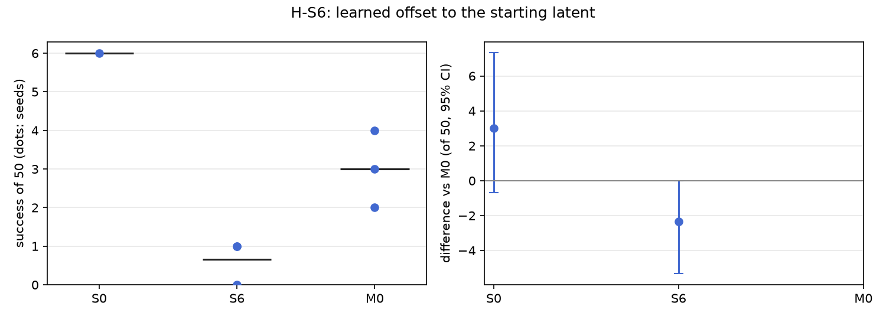

# H-S6: steering the latent, no weights changed

Plan S6 of RethoughtAI `training/sim_experiments.md` (part 1, against what? the alternatives,
simplest first).

## Claim

**Hypothesis H-S6.** A learned offset to z0 fixes some failures but less than M0, and forgets nothing
by construction. **Null:** the offset matches M0. **Expected outcome:** S6 between S0 and M0;
forgetting near zero. **Falsified if** S6 matches M0.

## Conditions

| # | What learns | Trainable parameters | Loss |
|---|---|---|---|
| M0 | LoRA rank 16 on the flow net's 8 linear layers | 327,680 | flow error on the corrected latents, anchor on base pairs |
| S6 | an MLP (one hidden layer, 319 units, output zero at the start) from the observation latent z0 to an offset added to z0; every policy weight frozen | 327,487 | the same flow error, through the frozen flow net, from the offset z0 |

The hidden width is chosen so that S6 has M0's parameter count. The offset is applied at every frame
the policy sees; alpha scales it (1 here).

Kept from M0: the 3 cm gate, corrections from pool episodes 21, 25, 29, 33 (363 corrected frames),
anchor lambda 0.5 on episodes 0 to 20 (8456 frames), 200 steps, batch 256, learning rate 1e-4,
alpha 1. Update seeds 0, 1, 2.

## Data and models

- Base: `andnetdeboer/vita_BlueCupRedContainer_sim_lead640ms_train21_s0-ema` (VITA, episodes 0 to 20,
  training seed 0, 30k steps), trained on
  `andnetdeboer/BlueCupRedContainer_sim_lead640ms_train21@540eca6ef5fabde564ea8c7c23465f8bc1af1db0`.
- Corrections, anchor and open-loop episodes:
  `andnetdeboer/BlueCupRedContainer_sim_lead640ms@b16f755bce0795c50840bb92358d3815b13c046e`, pool
  episodes 21, 25, 29, 33; anchor episodes 0 to 20; open-loop test episodes 38 to 55.
- Adapters not published.

## Closed-loop results

50 test layouts, 40 s per attempt. Difference: success averaged over the three update seeds per
layout, minus M0's, 95% bootstrap interval over layouts, in layouts of 50. Forgetting: mean change in
success on the 6 layouts the base solved (minus 1: all lost).

| Condition | Success of 50 per seed | Mean | Diff vs M0 [95%] | Forgetting | Solved layouts lost per seed (of 6) | Median time (s) | Phase none/reach/grasp/transfer/release (pooled) | Failure modes (pooled) | Corrected frames | Update (s, GPU) |
|---|---|---|---|---|---|---|---|---|---|---|
| S0 (base) | 6 | 6.0 | +3.0 [-0.7, +7.3] | | | 19.3 | 24/12/6/1/7 | missed grasp 23, timeout 8, stalled 8 | | |
| S6 (latent offset) | 0, 1, 1 | 0.7 | -2.3 [-5.3, +0.0] | -0.94 | 6, 5, 6 | 31.5 | 96/27/18/3/6 | missed grasp 102, stalled 17, dropped in transit 15 | 363 | 1.4, A100-SXM4-80GB |
| M0 | 4, 3, 2 | 3.0 | | -0.72 | 4, 4, 5 | 16.3 | 90/20/22/6/12 | missed grasp 77, stalled 21, timeout 20 | 363 | 2.1, A100-SXM4-80GB |

Success on the 6 solved layouts against M0 (layouts of 6, 95% interval): S6 -1.33 [-3.33, +0.67].
Against the base, S6 is -5.3 of 50. Its two successes took 31.5 s (median), against 16 to 19 s for M0
and the base.

Update compute is the wall time of the 200 steps on cached latents on a cluster GPU; attempts: none
(offline corrections).

## Open-loop results

Median per-episode path error (mm), alpha 1, mean over the three update seeds.

| Condition | Test episodes 38 to 55 (base 22.3) | Base episodes 0 to 20, forgetting (base 3.3) |
|---|---|---|
| S6 | 27.5 | 14.0 |
| M0 | 22.5 | 6.7 |

## Noise floor

Base training seeds: 6, 2, 3 of 50. S6's update seeds span 0 to 1 of 50, M0's 2 to 4. Any difference
under about 4 of 50 is inside the floor.

## Verdict: falsified

- The forgetting prediction fails clearly: S6 loses 17 of the 18 layout-seeds the base solved
  (forgetting -0.94, more than M0's -0.72), and open loop it moves furthest from the base's own
  episodes (14.0 mm against 6.7 for M0 and 3.3 for the base). No weight changes, but the offset is
  applied at every frame, so the base's behaviour changes everywhere.
- S6 does not lie between S0 and M0: at 0.7 of 50 it is below both. Against M0 the interval just
  reaches zero (-2.3 [-5.3, +0.0]) and the difference is under the noise floor, so by the plan's rule
  S6 matches M0 and the claim is falsified on that count too; the point estimate puts it lower still.
- Missed grasps dominate (102 pooled, against 77 for M0): the offset degrades grasping rather than
  fixing failures.

## Threats

- The plan's "forgets nothing by construction" holds for the weights, not for the behaviour: an offset
  network applied to every observation moves every plan. Only the anchor term (lambda 0.5) keeps the
  offset small on the base's own states; a gated offset (applied only where a correction would apply)
  was not tested.
- With the flow net frozen, the offset can only move z0 along directions the flow maps to the
  corrected latents; the 363 corrected frames may be too few for a 327k-parameter offset network.
- Forgetting rests on the 6 layouts the base solved.
- One base (training seed 0). All evaluations ran with the evaluator's per-layout random lighting, as
  for every condition.
