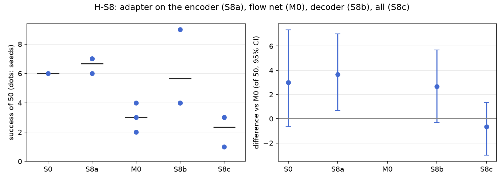

# H-S8: where the adapter sits

Plan S8 of RethoughtAI `training/sim_experiments.md` (part 2, every component earns its place).

## Claim

**Hypothesis H-S8.** The flow net (M0) is the right place: the failure is in which action the latent
flows to, not in perception. **Null:** the encoder or decoder does as well. **Expected outcome:** S8a
and S8b below M0; S8c within noise of M0, forgetting more. **Falsified if** S8a or S8b matches M0.

## Conditions

Every condition is M0 with one change, the layers that carry the LoRA adapter (and with it the loss
where the flow error alone cannot reach the adapter).

| # | Adapter on | LoRA layers | Trainable parameters | Loss |
|---|---|---|---|---|
| S8a | the observation encoder: the linear map from the frozen image backbone's features to z0 | 1 | 24,816 | the base's training objective (flow error plus its consistency and reconstruction terms) |
| M0 | the flow net: fc1 and fc2 of its 4 blocks | 8 | 327,680 | flow error |
| S8b | the action decoder: input, the fc1 and fc2 of its 4 blocks, output | 10 | 159,744 | the base's training objective |
| S8c | all three | 19 | 512,240 | the base's training objective |

The flow error does not reach the decoder, so every set that includes the encoder or the decoder
uses VITA's own objective with the checkpoint's weights; M0 uses the flow error.

Kept from M0: LoRA rank 16, the 3 cm gate, corrections from pool episodes 21, 25, 29, 33 (363
corrected frames), anchor lambda 0.5 on episodes 0 to 20 (8456 frames), 200 steps, batch 256,
learning rate 1e-4, alpha 1. Update seeds 0, 1, 2.

## Data and models

- Base: `andnetdeboer/vita_BlueCupRedContainer_sim_lead640ms_train21_s0-ema` (VITA, episodes 0 to 20,
  training seed 0, 30k steps), trained on
  `andnetdeboer/BlueCupRedContainer_sim_lead640ms_train21@540eca6ef5fabde564ea8c7c23465f8bc1af1db0`.
- Corrections, anchor and open-loop episodes:
  `andnetdeboer/BlueCupRedContainer_sim_lead640ms@b16f755bce0795c50840bb92358d3815b13c046e`, pool
  episodes 21, 25, 29, 33; anchor episodes 0 to 20; open-loop test episodes 38 to 55.
- Adapters not published. The policy runtime loads each adapter set by its recorded layers; the
  closed-loop runs log the adapter kind and layer count (S8a: 1 LoRA layer on the observation
  encoder, alpha 1).

## Closed-loop results

50 test layouts, 40 s per attempt. Difference: success averaged over the three update seeds per
layout, minus M0's, 95% bootstrap interval over layouts, in layouts of 50. Forgetting: mean change in
success on the 6 layouts the base solved (minus 1: all lost).

| Condition | Success of 50 per seed | Mean | Diff vs M0 [95%] | Forgetting | Solved layouts lost per seed (of 6) | Median time (s) | Phase none/reach/grasp/transfer/release (pooled) | Failure modes (pooled) | Corrected frames | Update (s, GPU) |
|---|---|---|---|---|---|---|---|---|---|---|
| S0 (base) | 6 | 6.0 | +3.0 [-0.7, +7.3] | | | 19.3 | 24/12/6/1/7 | missed grasp 23, timeout 8, stalled 8 | | |
| S8a (encoder) | 7, 7, 6 | 6.7 | +3.7 [+0.7, +7.0] | -0.61 | 3, 4, 4 | 15.1 | 68/27/31/3/21 | missed grasp 63, stalled 26, dropped in transit 21 | 363 | 8.9, A100-PCIE-40GB |
| M0 (flow net) | 4, 3, 2 | 3.0 | | -0.72 | 4, 4, 5 | 16.3 | 90/20/22/6/12 | missed grasp 77, stalled 21, timeout 20 | 363 | 2.1, A100-SXM4-80GB |
| S8b (decoder) | 9, 4, 4 | 5.7 | +2.7 [-0.3, +5.7] | -0.56 | 3, 3, 4 | 18.7 | 53/47/27/4/19 | missed grasp 62, stalled 28, dropped in transit 21 | 363 | 6.4, A100-SXM4-80GB |
| S8c (all three) | 3, 1, 3 | 2.3 | -0.7 [-3.0, +1.3] | -0.78 | 4, 6, 4 | 20.4 | 97/19/23/3/8 | missed grasp 78, stalled 28, timeout 19 | 363 | 14.4, A100-SXM4-80GB |

Success on the 6 solved layouts against M0 (layouts of 6, 95% interval): S8a +0.67 [-1.00, +2.33],
S8b +1.00 [-1.67, +3.33], S8c -0.33 [-1.33, +0.67]. Against the base: S8a +0.7 [-4.0, +5.3], S8b -0.3
[-4.3, +3.3] of 50.

Update compute is the wall time of the 200 steps on a cluster GPU; the base's objective decodes and
samples the flow each step, so S8a to S8c take 3 to 7 times M0's time. Attempts: none (offline
corrections).

## Open-loop results

Median per-episode path error (mm), alpha 1, mean over the three update seeds.

| Condition | Test episodes 38 to 55 (base 22.3) | Base episodes 0 to 20, forgetting (base 3.3) |
|---|---|---|
| S8a (encoder) | 22.7 | 5.6 |
| M0 (flow net) | 22.5 | 6.7 |
| S8b (decoder) | 22.3 | 4.5 |
| S8c (all three) | 23.1 | 5.0 |

## Noise floor

Base training seeds: 6, 2, 3 of 50. Update seeds within one condition span up to 5 of 50 (S8b: 4 to
9). Any difference under about 4 of 50 is inside the floor.

## Verdict: falsified

- Both other placements match M0, and point above it: the encoder adapter S8a +3.7 [+0.7, +7.0]
  (6.7 of 50, the highest of the four, all three seeds above M0's best), the decoder adapter S8b +2.7
  [-0.3, +5.7]. Neither falls below M0, so by the plan's rule the claim is falsified.
- Neither forgets more than M0 (S8a -0.61, S8b -0.56 against -0.72; open loop 5.6 and 4.5 mm
  against 6.7).
- The expected outcome for S8c holds in direction: within noise of M0 (-0.7 [-3.0, +1.3]) and
  forgetting slightly more closed loop (-0.78), though not open loop (5.0 mm).
- The hypothesis's reason cannot be tested: no placement gains over the base (best 6.7 against 6,
  +0.7 [-4.0, +5.3]), so there is no fix to locate in perception or in the flow. S8a's lead over M0
  is just under the noise floor; together with S3b, S5, S13a and S13b it fits M0 being a low draw.

## Threats

- S8a to S8c train with the base's full objective and M0 with the flow error alone: placement and
  loss change together.
- The encoder adapter is a single linear layer with 24,816 parameters, 13 times fewer than M0's; its
  result is not a capacity-matched comparison.
- M0 (3.0) may be a low draw: S8a's three seeds (7, 7, 6) are each above every M0 seed, but the
  difference stays under the noise floor and at the base's level.
- Forgetting rests on the 6 layouts the base solved. One base (training seed 0) and 363 corrected
  frames from 4 pool demonstrations. All evaluations ran with the evaluator's per-layout random
  lighting, as for every condition.
