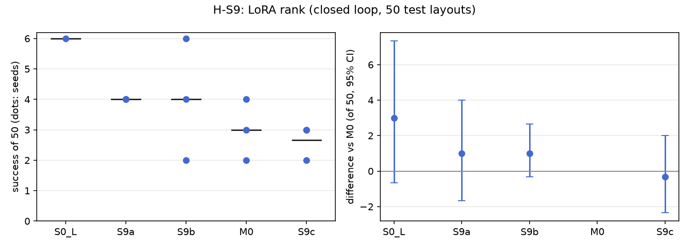

# H-S9: how much adapter capacity (LoRA rank)

Plan S9 of RethoughtAI `training/sim_experiments.md` (part 2, every component earns its place).

## Claim

**Hypothesis H-S9.** Ranks 4 to 64 are within noise of each other; rank 1 is below.
**Null:** gain keeps rising with rank. **Falsified if** S9c (rank 64) beats M0 (rank 16) beyond noise.

## Conditions

Every condition is M0 with one change, the LoRA rank on the flow net's 8 linear layers.

| # | Rank | Trainable parameters |
|---|---|---|
| S9a | 1 | 20,480 |
| S9b | 4 | 81,920 |
| M0 | 16 | 327,680 |
| S9c | 64 | 1,310,720 |

Kept from M0: anchor lambda 0.5, the 3 cm gate, corrections from pool episodes 21, 25, 29 and 33
(363 corrected frames), 200 steps, batch 256, learning rate 1e-4, alpha 1. Each condition was run
with update seeds 0, 1 and 2.

## Data and models

- Base: VITA, episodes 0 to 20, training seed 0, 30k steps, EMA weights:
  `andnetdeboer/vita_BlueCupRedContainer_sim_lead640ms_train21_s0-ema`, trained on
  `andnetdeboer/BlueCupRedContainer_sim_lead640ms_train21@540eca6ef5fabde564ea8c7c23465f8bc1af1db0`.
- Corrections and anchor: `andnetdeboer/BlueCupRedContainer_sim_lead640ms@b16f755bce0795c50840bb92358d3815b13c046e`,
  pool episodes 21, 25, 29, 33 (corrections), episodes 0 to 20 (anchor, 8456 frames), episodes 38
  to 55 (open-loop test).
- The `_lead640ms` datasets are the sim source with the pose labels led by 16 steps (640 ms), the
  robot's label convention; see the threats section of the README for why.
- The adapters (a few MB each) were not published.

## Closed-loop results

50 test layouts (seeds 1000 to 1049), 40 s per attempt, run through the robot's runtime profile.
Difference: success averaged over the three update seeds per layout, minus M0's, with the 95%
bootstrap interval over layouts, in layouts of 50. Forgetting: mean change in success on the 6
layouts the base solved (minus 1 means all lost).

| Condition | Success of 50 per seed | Mean | Diff vs M0 [95%] | Forgetting | Median time (s) | Phase none/reach/grasp/transfer/release (pooled) | Failure modes (pooled) | Corrected frames | Update (s, GPU) |
|---|---|---|---|---|---|---|---|---|---|
| S0 (base) | 6 | 6.0 | +3.0 [-0.7, +7.3] | | 19.3 | 24/12/6/1/7 | missed grasp 23, timeout 8, stalled 8 | | |
| S9a (rank 1) | 4, 4, 4 | 4.0 | +1.0 [-1.7, +4.0] | -0.72 | 16.7 | 71/39/20/3/17 | missed grasp 78, stalled 23, timeout 16 | 363 | 2.9, A100-PCIE-40GB |
| S9b (rank 4) | 4, 6, 2 | 4.0 | +1.0 [-0.3, +2.7] | -0.78 | 17.2 | 93/25/15/1/16 | missed grasp 71, timeout 29, stalled 27 | 363 | 2.5, A100-PCIE-40GB |
| M0 (rank 16) | 4, 3, 2 | 3.0 | | -0.72 | 16.3 | 90/20/22/6/12 | missed grasp 77, stalled 21, timeout 20 | 363 | 2.1, A100-SXM4-80GB |
| S9c (rank 64) | 3, 3, 2 | 2.7 | -0.3 [-2.3, +2.0] | -0.78 | 19.6 | 94/22/21/2/11 | missed grasp 80, stalled 26, dropped in transit 15 | 363 | 2.6, A100-PCIE-40GB |

Update compute is the wall time of the 200 update steps on cached latents, on a cluster GPU (the
plan's figure is the robot computer's); attempts: none (offline corrections).

## Open-loop results

Median per-episode path error (mm) on the 18 open-loop test episodes (38 to 55) and on the 21 base
episodes (forgetting), alpha 1, mean over the three update seeds.

| Condition | Test (base 22.3) | Base episodes (base 3.3) |
|---|---|---|
| S9a | 22.8 | 4.8 |
| S9b | 23.0 | 5.7 |
| M0 | 22.5 | 6.7 |
| S9c | 22.8 | 7.3 |

Open-loop forgetting grows with rank (4.8, 5.7, 6.7, 7.3 mm); test error does not improve at any rank.

## Noise floor

Base training seeds (S0, S0b, S0c): 6, 2 and 3 of 50. Update seeds of one condition span up to 4 of
50 (S9b: 2 to 6). Any difference under about 4 of 50 is inside the noise floor.

## Verdict: inconclusive

- Not falsified: S9c does not beat M0 (difference -0.3 of 50, interval [-2.3, +2.0]), and success
  does not rise with rank (4.0, 4.0, 3.0, 2.7 for ranks 1, 4, 16, 64), so the null is not supported.
- Ranks 4 to 64 are within noise of each other, as predicted. Rank 1 is not below; it is level with
  rank 4.
- The comparison is uninformative about capacity, because no adapter in this plan helps: M0 itself is
  3.0 of 50 against the base's 6 (H-S9 presumes an M0 gain to scale). With no gain, rank only changes
  how much the update disturbs the base: open-loop error on the base episodes rises steadily with rank,
  and every adapter loses about three quarters of the layouts the base solved.

## Threats

- The base is weak (6 of 50), so the 6 layouts behind the forgetting figure make it noisy, and the
  paired differences sit near the floor of what 50 layouts can resolve.
- All ranks share the same 363 corrected frames from 4 pool demonstrations. The offline corrector
  only covers states the demonstrations visited; the closed-loop failures are mostly missed grasps
  near the cup, where the policy's own states differ from the demonstrations'.
- One base (training seed 0) carries every adaptation; the base seed spread (2 to 6) is as large as
  any effect here.
